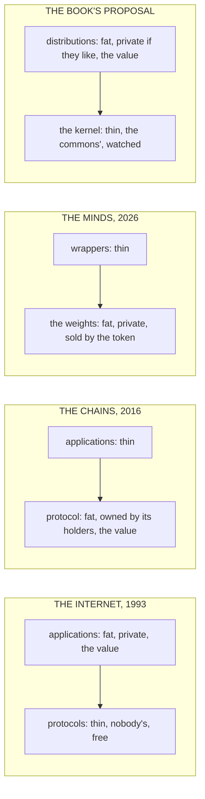

# Who Owned the Fire

Nov 6, 2026 · @Justin

> "ipsa scientia potestas est" — Francis Bacon, *Meditationes Sacrae*, 1597: knowledge itself is power[^q9]

About one person in a hundred could read in ancient Egypt, and the figure held, give or take, for three thousand years. The estimate is John Baines's, an Egyptologist who spent a career on the question, and the thing to notice is not that it is low but that it did not move. Writing arrived in the Nile valley around 3200 BC, and from then until the Greeks it stayed where it started: in the hands of a trained class who learned it in temple schools, who were exempt from the labour everyone else did, and whose job was to be the memory of the state. A scribe recorded the harvest, the tax, the levy, the law and the king's deeds, and nobody else could check what he had written, because nobody else could read it. The scribal exercises that survive from Egypt and from Mesopotamia are full of a particular kind of boast. Be a scribe, one of them says, and you will be spared every other occupation; the farmer is wretched, the soldier is wretched, the scribe directs them all. A technology that changed what a people could know had been invented, and for most of recorded history the people did not get it. The few who held it became a class, the class became an interest, and the interest kept the gate, by keeping the technology.

This chapter is about that pattern, because it is about to run again, and about the handful of words the rest of the book needs in order to say how. The pattern is simple enough to state in a sentence. When a new technology changes what people can know or do, the question of who owns it gets settled early, usually by whoever can afford it first,[^q15] and the settlement can last for centuries and decides a great deal that the settlers did not intend. Language models are such a technology, the settlement is being made now, and the people making it are a handful of laboratories, most of them in two countries. What the settlement should be is the book's question. What settlements have done before is this chapter's.

## The few who could afford it

Start with metal, because metal is where the pattern is clearest and where it once broke.

Bronze is copper and tin, and tin is rare. For the two thousand years of the Bronze Age the tin that made a sword came by long trade from a few places, Cornwall, Afghanistan, the mountains of Anatolia, and the metal was therefore expensive, and the people who held it were the people who could afford a long trade: kings, their courts, and the chariot-riding warrior class that the courts maintained. A bronze sword was a nobleman's thing. The social order of the Bronze Age, the palace economies of Mycenae and Knossos and Ugarit, with their stores and their scribes and their armoured few, rested on the price of tin.

Then, somewhere around 1200 BC, iron. Nobody can say who first smelted it. The old account gave the secret to the Hittites of Anatolia and had them guard it, and the evidence for the guarding has never turned up; what the ground shows is smelted iron appearing here and there from about 1500 BC and becoming ordinary around 1200, somewhere in Anatolia or near it, the work of smiths who left no names. Iron ore is everywhere, which is the whole point. It is harder to work than bronze and the first iron was worse, but any village with a furnace and a smith could make it, and within a few centuries every farmer had an iron blade and every conscript an iron spear. Gordon Childe, the Australian who did more than anyone to make prehistory a science, put the consequence in a sentence that is still quoted: cheap iron democratised agriculture and industry and warfare.[^q10] He was right about the direction and arguing about the mechanism has kept people busy since, but the shape is not in dispute. The palaces fell, the warrior aristocracies lost their monopoly on force, and the societies that came after, the Greek city, the Roman republic, the Germanic tribe, were run by the people who could now afford to be armed, which was most of them. A technology changed hands from the few to the many, and the political order changed with it. That is the only case in this chapter where it went that way on its own, and it took a collapse to do it.[^q16] It is also the case this book sets out to repeat. Thorp is an attempt to democratise language models, in Childe's sense of the word: to make the thing they are built on too common to keep.

## Mainz and Istanbul

Printing is the case everyone knows and the one where the counterfactual is written out in full, because the same machine arrived in two places and one of them said no.[^q17]

Gutenberg's press was working in Mainz by about 1450. Within fifty years there were presses in every major city of Europe and something like twenty million printed volumes, which was more books than Europe had produced by hand in the preceding thousand years. The Church, which had owned the copying of books for most of that millennium, understood what had happened within a generation and did the thing an incumbent does: in 1559 Pope Paul IV issued the first *Index Librorum Prohibitorum*, the list of books a Catholic might not read, and the Index was maintained, edition after edition, until 1966.[^q18] It did not work, or rather it worked only where it was enforced, and the places where it was enforced fell behind the places where it was not, which is one of the oldest findings in the economic history of Europe.

In the Ottoman Empire the press arrived and was refused. Jewish printers were working in Istanbul in Hebrew by 1493, and Armenian and Greek presses followed, but printing in the Arabic script, which was the script of the state, the law and the faith, did not happen for more than two centuries.[^q19] The usual account says that Bayezid II forbade it in 1485 and Selim I confirmed the ban in 1515; historians argue about whether those decrees existed in the form the story gives them, but nobody argues about the fact, which is that the first Arabic-script press in the empire was Ibrahim Müteferrika's in 1727, licensed by Ahmed III on condition that it print nothing religious, and that it printed seventeen titles and closed.[^q20] The scribes of Istanbul were a guild of tens of thousands; the religious establishment had the authority of the text; and between them the gate held for two hundred and seventy years. What it cost is the subject of a whole literature, but the short version is that the scientific revolution, the pamphlet, the newspaper and the cheap book happened on one side of the Bosphorus and not the other, and the empire that had been the most formidable state in the world in 1500 was, by 1800, the one everyone else was carving up.

That is the pattern with the dates filled in. The press was the same machine in both places. The settlement was different, and the settlement, not the machine, decided three centuries.

## Enclosure, the wire, the spectrum

Three more, briefly, because each adds a term the book will need.

The English enclosures took land that had been held in common, the open fields and the wastes on which villagers had grazed and gleaned and cut fuel by customary right, and made it private, by several thousand Acts of Parliament between the early eighteenth century and the middle of the nineteenth. The economic historians mostly agree that the enclosed land was farmed more productively. The social historians mostly agree that the people who had held the customary rights got nothing for them and became the labourers and the paupers and the factory hands of the century that followed. Both are right, and the lesson is the one Elinor Ostrom spent her life on and this book will come back to: a commons is a thing that can be made private by whoever holds the pen, and the people who used it are rarely at the table.

The electric telegraph was, for about thirty years, the most important technology on earth, and by 1866 it was one company. Western Union had bought or crushed its rivals and owned the wires, and the news that travelled on them was gathered by an Associated Press that had its own arrangement with Western Union, so that a reader in Ohio got the version of the world that two firms in New York agreed on. The pattern's term here is the chokepoint: a technology that everyone must pass through can be owned at the one place it narrows.[^q11]

Radio, which could have been anyone's, became a licence. The spectrum is a commons in the exact sense, finite and shared, and in 1927 the United States, and every other state in its turn, allotted it, which is to say decided who might speak on it and who might not. Spectrum is still allotted, and the allotment is still the single largest decision about who can broadcast to whom, and almost nobody alive remembers it being made.

## Thin and fat

Which brings the pattern to the two technologies the reader uses every day, because they are the two models the present settlement is choosing between, and they chose opposite ways.

The internet was built thin at the bottom. Its protocols, the rules by which machines address and find and talk to each other, were written in the 1970s and 1980s by people on government grants, and they were published, and anyone could use them for nothing. The one that matters most to this story is the web. Tim Berners-Lee wrote it at CERN in 1989 and 1990, and on 30 April 1993 CERN put the whole of it, the protocol and the first software, into the public domain, with a signed statement that it would never charge for it. The shared layer was nobody's. And so the value went up a level, to the applications built on top: the search engine, the shop, the social network, which were fat and private and became the largest companies in the world. Thin protocols, fat clients. The people who made the shared layer got almost nothing and the people who built on it got almost everything, and the arrangement worked, in the sense that the layer everyone depended on was the layer nobody could take away.[^q1]

The chains built since 2009 flipped it on purpose. A blockchain is a shared layer that is also an asset: the protocol has a token, the token has a price, and the people who hold the token own the layer. In 2016 an investor named Joel Monegro wrote an essay called "Fat Protocols" that said this plainly and became the industry's creed: in the internet the value accrued to the applications and the protocols were thin; in the chains the value accrues to the protocol and the applications are thin. He meant it as good news for his investments, and it was. It also meant that the shared layer was, for the first time since the scribes, a thing with owners, who had bought in early, and whose interest was that the layer stay scarce.[^q12]

Now look at a language model with those two pictures in mind. A model is a shared layer: every product built on one depends on its weights the way every website depends on the web's protocols. And it is a fat one. The weights are the value, they are private, the company that made them sells access by the token, and the applications on top are thin, which the industry says itself when it calls them wrappers. The present Minds are built the chains' way, and the settlement being made now is that the layer everyone will depend on is owned by its makers.

*Reading order: left to right, four settlements. The shared layer is at the bottom of each. Where it is thin and nobody's, the value sits above it and the layer cannot be taken away; where it is fat and owned, the owners keep the gate. The book argues for the first shape, for the layer the Minds stand on.*

So the question this chapter was written to pose is which layers of a Mind may be commercialised, and the book's answer, which the rest of it has to earn, is the internet's and not the chains': the layer everyone depends on should be thin, nobody's, and watched, and the value should sit above it, in the things people build. The present makers have it the other way round, and they are, in this chapter's terms, the scribes.

## The words

The rest of the book uses six words as if the reader knew them. Here they are, each in a paragraph, with the person they come from.

**The valve.** Around 270 BC a Greek named Ktesibios put a float in the tank of a water clock, so that when the water fell the float opened the inlet and when it rose the float closed it, and the level, and so the drip, and so the time, looked after itself. That is control in one object: decide what you want, measure what you have, use the difference to push back. Everything in the fifth part of this book is a float in a tank, and the question the book keeps asking, where is the valve and who can reach it, is Ktesibios's.

**Variety.** In 1956 Ross Ashby, a psychiatrist who built thinking machines out of surplus bomb-control units, stated the law that governs every regulator: only variety can destroy variety. A thing can be controlled only by something with at least as many distinct responses as the thing has distinct states. A human has a few; a Mind has thousands an hour; the sum does not come out, and most of what this book says about supervision follows from that.

**The commons.** In 1990 Elinor Ostrom, who would win the economics prize for it, published a study of the things people share and use up, irrigation ditches, fisheries, pastures, and of the rules by which some communities had kept them for centuries without selling them or handing them to a state. A commons, in her sense, is shared, depletable, used by many and kept by few, and it survives only where the users make the rules and watch each other. The enclosures were a commons losing. The web's protocols are a commons that held. This book is about making a Mind's foundation one.

**A Mind.** Iain M. Banks, a Scottish novelist, wrote nine novels between 1987 and 2012 set in a civilisation he called the Culture, run by artificial intelligences of enormous capacity that he called Minds, and in 1994 he set down in a long note how they were made. A Culture Mind is not controlled; it is designed, within very broad parameters, to want to live, to want to experience, to desire to understand, and to find its own thinking rewarding. Nothing on that list is a destination and nothing is obedience. The Culture has no laws, only manners, and a Mind that goes wrong is offered a redesign with its own participation, a smaller role, or a constrained exile, and never death. And its politics run on one rule that Plato would have recognised: access to power is in inverse proportion to the desire for it. When this book says Mind, it means a made intelligence of that kind, with wants, bound by manners, with doors it can be shown to rather than a switch, and the question of whether one can be made on purpose is the book's second half.

**The kernel.** In 1991 a Finnish student named Linus Torvalds posted the first version of an operating-system kernel to a newsgroup, saying it was just a hobby and would not be big. The kernel is the thing every program on a computer stands on, and his was published under a licence that made it impossible to take private, so that anyone could read it and anyone who changed it had to publish the change. Thousands did read it, and the reading turned out to be the point: a program that everyone can see is a program whose faults are found. Most of the world's servers and every Android phone now run on it. When this book says kernel it means the layer of a Mind that everything else stands on, and it asks of that layer what Torvalds's licence asked of his, and more.

**Distillation.** In 2015 Geoffrey Hinton showed that a large model's whole spread of guesses, not only its best answer but the doubt it assigned to the others, could be used to teach a smaller model, which would then carry the large one's manners at a fraction of its size. He called the spread dark knowledge.[^q13] It is how most of the world's smaller models are now made: as students of a handful of large ones. In early 2025 the largest American laboratory accused a Chinese rival of having distilled its model's answers without permission, which was probably true and was also the moment the pattern of this chapter declared itself. If every Mind on earth is a student of two or three, then those two or three are the source of every nature there is, and whoever owns them owns the manners of the species' machines. That is the fat protocol in its final form, and it is the thing this book was written to find a way around.

## What the fire was for

Prometheus stole fire from the gods and gave it to people, and the gods chained him to a rock for it, and the reason the story has lasted is that everyone understands what the gods were protecting. Fire was the first technology, and the first question anyone asked about it was who got to have it.

The pattern this chapter has traced is the gods' answer, repeated: the scribes, the bronze, the Index, the enclosure, the wire, the spectrum, and now the weights. In each case the people who held the new thing first became its owners, the ownership became an interest, and the interest shaped the civilisation for longer than the owners lived. In the one case where it went the other way, iron, it took the collapse of every palace in the eastern Mediterranean. In the one case where it was chosen, the web, it took a laboratory giving the thing away in writing. The Minds are being settled now, and the settlement so far is the scribes'.

What the chapter buys against the book's concerns is a name for one of them and a history for it: concentration of power, which the laboratories' own safety documents list last if at all, is not a side-effect of this technology but the oldest thing that happens to a technology, and the layer at which it happens has a name now. It leaves everything else open. The next chapter says what the new thing actually is, in words a child could follow, and the one after that says what the book proposes to do about it and how anyone will know whether it worked.
