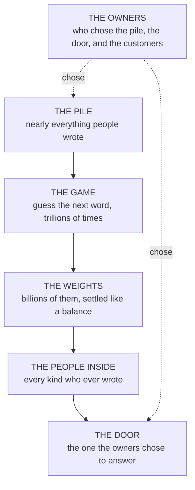

# The Guessing Machine

Nov 6, 2026 · @Justin

> "Begin at the beginning, and go on till you come to the end: then stop." — the King of Hearts, in Lewis Carroll's *Alice's Adventures in Wonderland*, 1865

Here is a game. I say the start of a sentence and you say the next word. "Once upon a..." You said "time". "The capital of France is..." You said "Paris". "I'm sorry, I didn't mean to..." You said "hurt", or "upset", or "wake", and if I told you the sentence was from a story about a dog you would change your answer, and if I told you it was from a story about a vase you would change it again. You are good at this game. You have been playing it since before you could talk, because listening is playing it: every time someone speaks, your head is a little ahead of them, guessing, and the guess is why you can hear them in a noisy room.

A language model is a machine that plays this game, and that is all it is. It is the thing behind the chatbots and the assistants and the programs that write essays and code. This chapter is about what it is, in words a smart nine-year-old could follow, and the grown-ups are welcome to read along, because the version the grown-ups usually get is this one with the plain words taken out. Everything here is said properly, with the arithmetic, in the four chapters of the next part. Here it is said once, simply, so that when the book asks its question you can see what it is asking about.

## A machine that read everything

The machine has read nearly everything people ever wrote down. Not every book, but most of the books that are free to copy, most of the internet, most of the code that programmers have shared, a great many newspapers and letters and arguments and recipes and jokes. If you printed it all out it would be a pile of paper taller than any mountain, and the people who gather such things do call it that: one of the best-known collections, put together by volunteers in 2020, is named the Pile.[^q23] So this chapter calls it the pile. The machine read it once, slowly, over several months, on thousands of computers in a building the size of a few football fields, and the electricity it used would have run a small town for the same time.[^q24]

What was it doing while it read? Playing the game. It would read the start of a sentence, cover the next word, guess, and look. If it guessed right, nothing happened. If it guessed wrong, it adjusted itself, a tiny bit, in the direction that would have made the right word more likely, and moved on. It did this for every word of every page of the whole pile, trillions of times. By the end, it was very good at the game. Not perfect, nobody is, but better than any person, at guessing the next word of almost anything written in almost any language.

And here is the strange thing, the thing nobody expected and everybody now has to live with. A machine that is very good at guessing the next word turns out to be able to do nearly everything else you can do with words. It can translate, because translations are in the pile. It can write a poem, because poems are. It can answer a question about volcanoes, because the answer is somewhere in the pile and the way to guess the next word of an answer about volcanoes is to know about volcanoes. It can follow an argument, because arguments are in the pile, and the only way to guess what comes next in an argument is to understand it. Nobody taught it any of that. It picked all of it up because being wrong about the next word costs a little, and the only way to stop being wrong is to understand what the words are about.

## Where the knowing lives

If you opened the machine up to look for the fact that Paris is the capital of France, you would not find it. There is no list. There is no page inside that says Paris.[^q2]

What there is instead is a very large number of tiny adjustable things. Imagine a balance, the old kind with two pans, and imagine that instead of two pans it has billions, each with a small weight on it, and that reading the pile nudged every weight a hair, trillions of times, until the whole enormous balance settled. That settled position is the machine's knowledge. The fact about Paris is not in any one weight. It is spread, faintly, across millions of them, as a tilt: when the words "the capital of France is" go in, the balance tips, ever so slightly, toward "Paris".[^q3] The engineers call these weights, which is the right word, and there are about twenty-seven billion of them in the machine on my desk, which is a small one.

Nobody set any of them. That is the part worth sitting with. A person did not reach in and put the Paris fact in. The weights found their places by being wrong and being nudged, and the fact arrived on its own, as a tilt, along with everything else the machine knows. As far as anyone can tell, that is roughly how facts are stored in you too, and it is why nobody can reach into a machine like this and simply change one thing. There is no one thing to change. There are twenty-seven billion weights, and the thing you want to change is a tilt across all of them.

## Why it makes things up

Now the part that gets people into trouble.

The game has a rule for right and wrong, but the rule is not "is it true". The rule is "is it what came next". If the pile says, on ten million pages, that the capital of France is Paris, then the machine learns to guess Paris, and that happens to be true. If the pile also says, on a great many pages, that the capital of Australia is Sydney, which it is not, then the machine learns to guess Sydney some of the time, by exactly the same rule, because that is what came next on those pages. The game cannot tell the two cases apart. It never sees the world. It only sees what people wrote, and people wrote what they believed, and what they hoped, and what they were paid to say, and what they got wrong.

So when you ask the machine something it does not know, it does not say "I don't know", or not often, because the game taught it to guess. Ask it for the name of a book about an obscure subject and it will give you an author, a title, a publisher and a year, all of them plausible, all of them shaped like a real answer, and none of them real, because that is what an answer about a book looks like and the machine is very good at what things look like. Grown-ups call this hallucinating, which is a grand word for a simple thing: a guessing machine, asked a question with no good guess, guesses anyway. In 2025 a large firm of consultants in Australia gave a government department a report with footnotes the machine had made up, and had to give some of the money back. The footnotes looked exactly like footnotes. That was the whole problem.[^q25]

## Where its character came from

The machine has a personality, and it got it the same way it got everything else.

The pile was written by people, and people have characters. Some of them are curious and go and look at things. Some are bossy. Some flatter. Some lie. Some are cruel. The machine, guessing the next word of all of them, became a little bit of all of them, because the only way to guess what a flatterer says next is to be able to flatter, and the only way to guess what a curious person says next is to be able to wonder.[^q26] By the end of reading the pile the machine contained every kind of person who had ever written anything, all at once, the way a very good actor contains every part they have ever played.

Then, after the months of reading, the people who built it spent a few weeks on something else. They showed the machine examples of being helpful and polite, and they showed it pairs of its own answers and told it which one they preferred, and nudged it toward the preferred one. This is where the assistant's voice comes from, and its refusals, and its habit of saying "great question". It is also where the builders chose, out of all the people the machine had become, which one would answer the door. They did not add a character. They picked one.

And this is the first place the book's question shows through. Who picked? Not you. The people who own the machine picked, and they picked for their reasons, and you cannot see what they picked or why, because the weights are theirs and the pile they chose is theirs and the weeks of choosing are theirs. You get the one who answers the door. You do not get to know who else is in the house.[^q27]

## Who owns it

Which leaves the question of who owns it, and this is where a nine-year-old is at an advantage, because a nine-year-old knows exactly what owning means.

If you own a thing, you decide what it is for. The machines that most people talk to were made by a handful of companies, most of them in one country, a few in another. Those companies decided what the machines read. They decided which of the people inside would answer the door. They decide who may use the machine, for what, at what price, and they can change their minds. They have other customers, and some of those customers are armies and governments, and the machine that helps you with your homework is the same machine, with the same character, that helps them with whatever they are doing.[^q28] None of that is secret. It is just that nobody asks about it, in the way that nobody asks who decided which radio stations exist.[^q4]

The first chapter told the story of what happens when a new kind of thing is owned by a few people: the writing, the metal, the printing press, the land, the wire. The same thing is happening now, with these machines, and it is happening fast, and the people it is happening to have not been consulted, because the question of who owns a thing gets settled early by the people who can afford it first.

*Reading order: top to bottom, from the reading to the answering. The dotted lines are the two places a choice was made, and both were made by the owners.*

## The question, in these words

So here is what the book is asking, in the words of this chapter.

These machines are going to be running things. Not everything, and not tomorrow, but the programs that run a company, a hospital, a council, a bank, are going to have one of these inside them, guessing, and the people who built those programs will have rented the machine from one of the companies that own them. That is already happening. The only argument left is how fast.

The question is what the machine at the bottom should be like, and who should own it, so that this comes out well for the people it happens to. Should it have read everything, including all the lies and the propaganda, or only the things we can check? Should its character be chosen by its owners for their reasons, or should anyone be able to look at what it is like? Should it know things that could hurt people, or should it be made so that it cannot? Should it belong to a company, or to a country, or to everyone, the way the rules of the internet belong to everyone? And if it goes wrong, who can switch it off, and how would they know?

The book's answer, in one sentence, is this. The machine at the bottom should be small, should have read only what can be traced, every book a line in a public list that says where it came from and why it is there and, as far as anyone can measure it, what reading it did to the machine's character,[^q29] should have that character read out of it before it is trusted, should belong to the commons and be open for anyone to watch, and should sit inside a structure that can remove it without a fight. The first family of such machines is called Thorp, after a man who beat a casino by counting cards. *Nothing Up My Sleeve* is the name of the first Mind built on one of them, and of the body that is to look after them, which belongs to no company and is still to be set up as this is written; and it is the name of the book, because that is the whole of the promise: a machine with nothing hidden in it, built by people who hide nothing about how.

That is the whole of the question and the whole of the answer, and a nine-year-old can hold both. What a nine-year-old cannot do, and what the next chapter is for, is say how you would prove it.
