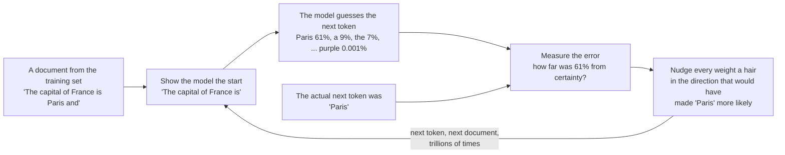
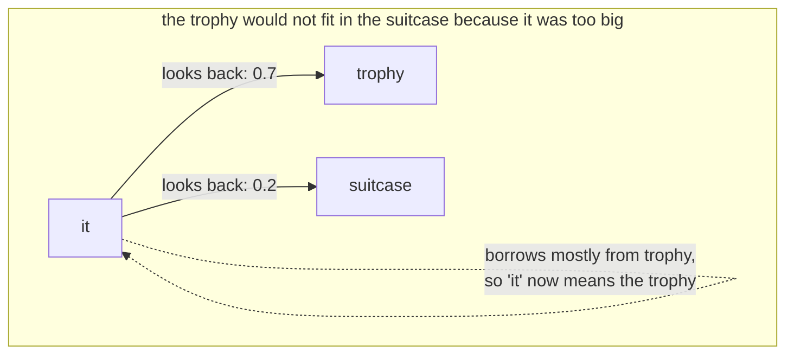

# Found, Not Chosen

Nov 5, 2026 · @Justin

*On a machine in a Navy laboratory whose knobs were turned by electric motors, twenty-seven billion of the same knobs turned by arithmetic, the modest task that produced something that can read a contract, the word that gave the field its founding paper, and a famous objection that the whole approach is a detour.*

In July 1958 the United States Navy showed the press a machine called [the Mark I Perceptron](peek:perceptron), built by a psychologist named Frank Rosenblatt at the Cornell Aeronautical Laboratory, and *The New York Times* reported that the Navy expected it to be "the embryo of an electronic computer" that would one day "walk, talk, see, write, reproduce itself and be conscious of its existence". It was a cabinet the size of a wardrobe. It had four hundred photocells for an eye, and it learned to tell simple shapes apart, and the part that I find impossible to stop thinking about is how it learned. Its memory was a bank of potentiometers, which are the knobs on an old radio, and each knob was turned by a small electric motor. When the machine guessed wrong, the motors turned the knobs a little, in the direction that would have made the guess right. When it guessed right, they left them alone. Nobody set the knobs. The machine found their positions by being wrong, repeatedly, and turning.

The model on my desk has twenty-seven billion knobs and no motors, and in every way that matters it is Rosenblatt's cabinet.[^q8] Its knobs are numbers rather than potentiometers, the turning is arithmetic rather than electricity, and the task is guessing text rather than shapes, but the principle is the one the Navy saw in 1958: the settings are found, not chosen, by a machine that is told when it is wrong and nudged toward being less so. This essay is about that principle, because the later essays in this set keep saying "parameters" and "training" and "attention" as if everyone knew what they were, and because a reader who understands how the knobs got where they are understands, without being told, why nobody can simply reach in and set a Mind's character by hand.

## A parameter is a knob

Start with the word, because it has two meanings in these essays and they are nearly opposite.

When Iain Banks wrote that the Culture's Minds are designed "within very broad parameters", he meant limits: the outer bounds inside which a Mind is free. When an engineer says the model has twenty-seven billion parameters, she means knobs: the numbers inside the model that training sets, every one of which is free to be anything and ends up where the data pushed it. The statisticians who chose the word a century ago meant the second thing. A formula for a line has two parameters, its slope and where it crosses the axis, and fitting the line to some points means finding the two numbers that make it pass closest to them. A language model is a formula with twenty-seven billion such numbers, and training it is fitting it to the written record of the human race.

The numbers mostly come in one shape, which is why engineers also call them weights. Inside the model a piece of text is not letters; it is a list of a few thousand numbers, a point in a space with that many dimensions, and nearly everything the model does is to take such a list and multiply it by a grid of weights to get a new list. Each weight says how much of one number in the old list flows into one number in the new; a grid of a few thousand by a few thousand is a few million weights; the model has thousands of grids. That is where the twenty-seven billion live, and there is nothing else in the file. No rules. No dictionary. No sentence anywhere that says Paris is in France. The fact that Paris is in France is spread, faintly, across millions of weights, as a bias in how numbers get multiplied, so that when the list of numbers for "the capital of France is" goes through the grids, the list that comes out happens to be close to the list for "Paris". That sounds like a trick, and it is, and it is also, as far as anyone can tell, roughly how the fact is stored in you.

## The modest task

Here is the thing that the first version of this explanation glossed over, and that a reader rightly objected to, because it is the hinge of the whole subject. What was the model trained to do?

One thing. Given a stretch of text, guess the next piece. That is the entire objective of the months of training that made the file on my desk. Not to be helpful, not to be truthful, not to reason, not to be anything. To predict, as well as possible, what comes next in a document it has been shown the start of. The piece it guesses is called a token, which is a word or a part of one; the model's vocabulary is a list of about a hundred and fifty thousand tokens, and its output, every time, is a probability for each of them. "The capital of France is" produces a list in which "Paris" has most of the probability, " a" has a little, and "purple" has almost none, and the training loop works like this.

*Reading order: left to right, then round the loop. The motors on Rosenblatt's cabinet are the box labelled NUDGE; the only difference is that the arithmetic knows, for each of twenty-seven billion weights, which way to turn and by how much.*

The arithmetic that knows which way to turn is called backpropagation, worked out in its modern form in 1986 by David Rumelhart, Geoffrey Hinton and Ronald Williams, and it is the reason the cabinet could become the file. For each weight it computes how much the error would change if that weight moved a little, and then moves it the other way. Do this for every weight, for every token, for every document, and the error falls. The training set for a model of this size is on the order of tens of trillions of tokens, which is most of the public internet, a great many books, a great deal of code, and, in the later stages, text written on purpose to teach particular things; the maker of the model on my desk reported, for an earlier generation, thirty-six trillion. Reading it once takes thousands of specialised computers several months and a quantity of electricity that is usually described by comparison to a town.

And now the part that nobody predicted and everybody has to live with. A machine trained only to guess the next token, given enough knobs and enough text, turns out to be able to do nearly everything else. It can translate, because translations are in the text. It can write code, because code is in the text. It can follow an argument, because arguments are in the text, and the only way to guess the next line of an argument well is to have, somewhere in the grids, something that works like the argument. The modest objective turned out to be a forcing function: predicting the written record of a species well enough requires modelling, in some form, most of what the species knows. The field noticed this around 2020, when a model called GPT-3 with a hundred and seventy-five billion knobs started doing things its makers had not trained it for, and the sentence everyone uses is that the abilities emerged. I prefer Rosenblatt's cabinet. Nobody put the abilities in. They were found, because being wrong about the next word costs you a little, trillions of times, and the only way to stop being wrong is to understand.

One more thing the loop explains, which the later essays need. The file on my desk was not only trained to guess text. After the months of guessing, which the engineers call pretraining, there are weeks of a second kind of training, in which the model is shown examples of being an assistant, questions with good answers, and then is shown pairs of its own answers with a verdict on which was better, and nudged toward the better one. That second stage, called post-training, is where the helpfulness and the refusals and the voice come from, and where a laboratory's choices about character enter. The pretrained model is the written record, compressed. The post-trained model is the written record, compressed, taught to answer the door. Everything a later essay says about a model's nature is about what happens in those weeks, on top of those months.

## What "attention" names

The objection I was most glad to receive was this: if a parameter is a knob and the model is a formula, why is the founding paper of the field called "Attention Is All You Need", and why has the word not appeared? Because attention is not what the knobs are. It is one particular arrangement of them, and it is the arrangement that made the knobs worth having at this scale.

Before 2017, the models that read text read it one word at a time, carrying a summary forward, the way you might read a sentence through a slot that shows one word. The summary was a bottleneck: by the end of a long paragraph, the beginning had faded. In June 2017 eight researchers at Google published a paper proposing that the model dispense with the slot and instead, for every word, look back at every earlier word at once and take from each as much as it finds useful. The word "it" in "the trophy would not fit in the suitcase because it was too big" looks back, finds "trophy", and borrows its meaning; in the version with "too small", it looks back and finds "suitcase". This looking-back-and-borrowing is the layer they called attention, by analogy with the thing you do when you attend to one voice at a party. The paper's title was a boast that the new layer could replace everything that came before it, and the boast was correct, and the architecture it described, the transformer, is what every model in this set of essays is.

*Reading order: start at "it". The weights on the arrows are what attention computes, fresh, for every word of every sentence; the knobs that decide how to compute them are what training found.*

Why this mattered more than any earlier idea comes down to two facts. Attention has no bottleneck, so a model can hold a long document in view at once, which is why the model on my desk can read a contract rather than a sentence. And attention can be computed for all the words of a document at the same time rather than one after another, which meant the training loop could run on thousands of computers in parallel, which meant the knobs could number in the billions, which meant the modest task could find the abilities. The word on the paper's title is the name of a layer. The reason the paper is formative is that the layer let the knobs scale.

## Twenty-seven billion, and why

Which brings us to the number, and to the question of why not twenty-seven million or twenty-seven trillion.

In January 2020 a team at OpenAI led by Jared Kaplan published a paper on what they called scaling laws, and its finding was as unexpected as it was simple. If you plot how well a model guesses the next token against how many knobs it has, or how much text it has read, or how much computation it has spent, you get a straight line on a logarithmic chart, over many orders of magnitude, with no sign of a ceiling. Double the knobs, and the error falls by a predictable amount. Double them again, same again. Two years later a team at DeepMind refined this: for a given budget of computation, there is a best balance between knobs and text, and the field had been building models with too many knobs and too little reading; their seventy-billion-knob model, trained on four times the text, beat a two-hundred-and-eighty-billion one. Since then the recipe has been to read more rather than only to grow.

So the honest answer to why twenty-seven billion is that nobody chose it as a theory. The laws say bigger is better, smoothly, forever, within what has been tried, and the size you build is set by what you can afford to run. Twenty-seven billion is, in 2026, the point where a model is clever enough to be worth talking to and small enough, compressed, to fit on a good laptop. The same maker sells the model at other sizes, and the plan in the last essay of this set runs first on one a third of this size, because the experiments it borrows were invented there.

And now the objection, which a reader raised and which deserves a straight answer rather than a wave. Yann LeCun, who shared the 2018 Turing Award for the work that made all this possible and who ran artificial-intelligence research at Meta for a decade, has argued for several years, loudly and in public, that guessing the next token is the wrong objective and that the whole line of work is, in his phrase, an off-ramp on the road to real intelligence. A four-year-old, he likes to point out, has taken in, through her eyes alone, more raw data than the largest language model has read, and she has learned from it how the world works, that objects persist and fall and cannot pass through each other, which no amount of text contains. His proposal, which he calls a joint-embedding predictive architecture, is a machine that learns to predict not the next word but the next state of the world, in an abstract space where the irrelevant detail has been thrown away, and he has argued that such a machine would need far fewer knobs to be far more capable, because it would be learning the world rather than the words about it. In late 2025 he left Meta to build one.

Has he proven it? No, and he would not claim to have; his group's video models of 2025 learned some physics from watching and are impressive and are not yet a Mind, and the claim that a world model needs fewer weights is an argument from what a child does, not a measurement. What is true is that the scaling laws are an empirical fact about this kind of machine and say nothing about whether it is the right kind; that a model trained to guess text has, demonstrably, no direct experience of the world and learns it only through what people wrote about it, which the fifth essay in this set is about; and that if LeCun is right, the file on my desk is a very good detour. These essays use it anyway, for a reason that does not depend on who wins the argument. It is the Mind that exists, it can be opened and read and nudged, and the question of whether a nature can be found in it is a question about this machine, not the next one.

## Found

Rosenblatt died in a boating accident in 1971, at forty-three, after a decade in which the field had decided his cabinet was a dead end, on the strength of a book proving that a single layer of knobs could not learn certain simple things, which was true and which missed that two layers could. The motors were not the mistake. The number of knobs was. It took fifteen years for the arithmetic that turns many layers of knobs at once to be written down, thirty more for the computers that could run it on billions of them, and a further decade for someone to notice that if you gave such a machine the whole of what people had written and asked it only to guess what came next, it would find in the guessing nearly everything they knew.

That is what the model on my desk is: twenty-seven billion knobs, found by being wrong trillions of times about the next word, and then taught for a few weeks to answer the door. Nothing in it was placed. Everything in it was arrived at. The next essay is about the stack of layers the knobs sit in, and the fact that nobody decides what each layer does either; and the point of this one, which the rest of the set stands on, is that a thing made this way cannot have its character set from the outside, by a sentence, the way you set a thermostat. The character was found with everything else. What can be done about it, the seventh essay says, is to find it in turn.
