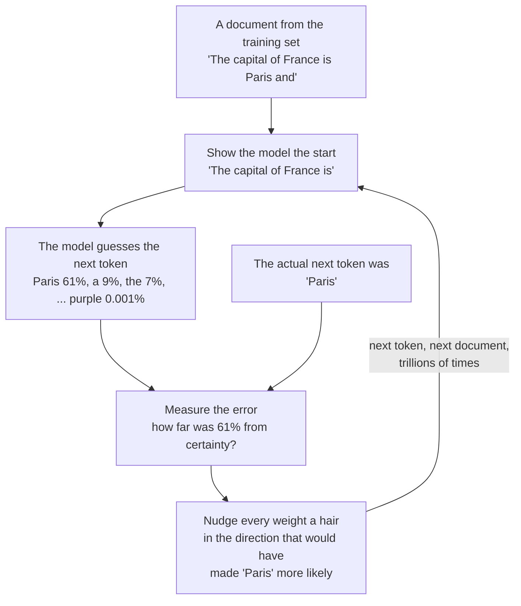
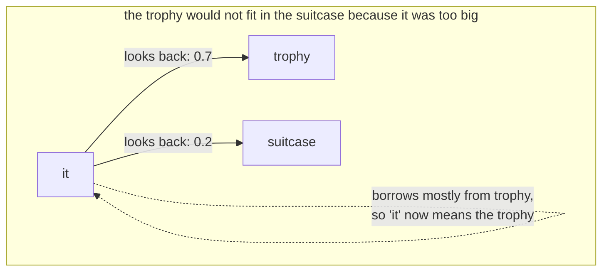

# Found, Not Chosen

Nov 5, 2026 · @Justin

> "We want AI agents that can discover like we can, not which contain what we have discovered." — Rich Sutton, "The Bitter Lesson", 2019

In July 1958 the United States Navy showed the press a machine called [the Mark I Perceptron](peek:perceptron), built by a psychologist named Frank Rosenblatt at the Cornell Aeronautical Laboratory, and *The New York Times* reported that the Navy expected it to be "the embryo of an electronic computer" that would one day "walk, talk, see, write, reproduce itself and be conscious of its existence". It was a cabinet the size of a wardrobe. It had four hundred photocells for an eye, and it learned to tell simple shapes apart. Its memory was a bank of potentiometers, which are the knobs on an old radio, and each knob was turned by a small electric motor. When the machine guessed wrong, the motors turned the knobs a little, in the direction that would have made the guess right. When it guessed right, they left them alone. Nobody set the knobs. The machine found their positions by being wrong, repeatedly, and turning.

The model on the desk has twenty-seven billion knobs and no motors, and in every way that matters it is Rosenblatt's cabinet.[^q8] Its knobs are numbers, the turning is arithmetic, and the task is guessing text rather than shapes, but the principle is the one the Navy saw in 1958: the settings are found, not chosen. The second chapter said that simply. This one shows the working.

## A parameter is a knob

The word has two meanings in this book and they are nearly opposite. When Iain Banks wrote that the Culture's Minds are designed "within very broad parameters", he meant limits: the outer bounds inside which a Mind is free. When an engineer says a model has twenty-seven billion parameters, she means knobs: the numbers inside it that training sets, each free to be anything and ending up where the data pushed it. The statisticians who chose the word a century ago meant the second thing. A formula for a line has two parameters, its slope and where it crosses the axis, and fitting the line to some points means finding the two numbers that bring it closest to them. A language model is a formula with a great many such numbers, and training it is fitting it to what people wrote.

How many is not fixed. It is the builder's choice, like the size of an engine: the smallest Thorp has three hundred thousand, the Thorp this book uses as its small example has nine million, the model on the desk has twenty-seven billion, and the largest laboratories do not publish theirs.

The numbers mostly come in one shape, which is why engineers also call them weights. Inside the model a piece of text is not letters; it is a list of a few thousand numbers, and nearly everything the model does is to take such a list and multiply it by a grid of weights to get a new list. Each weight says how much of one number in the old list flows into one number in the new. The grids are stacked in layers, and the picture to hold for a layer is a sieve: the list is poured through, the weights decide what passes and how much, and what comes out is the list, changed. The model on the desk has sixty-four sieves, one after another, and the next chapter is about them. The weights in the sieves are the whole of the file. There are no rules in it, no dictionary, and no sentence that says Paris is in France. That fact is the tilt the second chapter described: when the list for "the capital of France is" has been through the sieves, the list that comes out lies close to the list for "Paris". As far as anyone can tell, that is roughly how the fact is stored in you.[^q31]

## The modest task

What was the model trained to do? For the months that made the file, one thing. Given a stretch of text, guess the next piece. Not to be helpful, not to be truthful, not to reason. The piece it guesses is called a token, which is a word or a part of one; the vocabulary of the model on the desk is a list of about a hundred and fifty thousand of them, and its output, every time, is a probability for each. "The capital of France is" produces a list in which "Paris" has most of the probability,[^q33] " a" has a little, and "purple" has almost none, and the training loop works like this.

*Reading order: top to bottom, then round the loop. The motors on Rosenblatt's cabinet are the box labelled NUDGE; the difference is that the arithmetic knows, for every weight, which way to turn and by how much.*

The arithmetic is called backpropagation, worked out in its modern form in 1986 by David Rumelhart, Geoffrey Hinton and Ronald Williams, and it is the reason the cabinet could become the file. For each weight it computes how much the error would change if that weight moved a little, and then moves it the other way. Do this for every weight, for every token, for every document, and the error falls. For a model the size of the one on the desk the reading runs to tens of trillions of tokens: most of the public internet, a great many books, a great deal of code. Its maker reported thirty-six trillion for an earlier generation.

Nobody predicted what came of it. A machine trained only to guess the next token, given enough knobs and enough text, can do nearly everything else that is done with words. The modest objective is a forcing function: the only way to guess the next line of an argument well is to have, somewhere in the sieves, something that works like the argument. The field noticed around 2020, when a model called GPT-3, with a hundred and seventy-five billion knobs, started doing things its makers had not trained it for, and the word everyone uses is that the abilities emerged. I prefer Rosenblatt's cabinet. Nobody put the abilities in. They were found.

Guessing is the whole of the first stage, and it is not the whole of the training. After the months of it, which the engineers call pretraining, come weeks of a second kind, called post-training, and that is where one maker's model comes to differ from another's. Part of it is the same game played on chosen text: conversations with good answers, reasoning written out step by step, the exact form of a call to a tool. That is how a model learns to answer rather than continue, to show its working, and to reach for a calculator instead of guessing the sum. Part of it is a different game, in which the model's own answers are judged and it is nudged toward the ones judged better. Its manners, its refusals and its voice come from those weeks, and so do its tool calls and its habit of reasoning. The pretrained model is the written record, compressed. The post-trained model is the record taught to answer the door.

## What "attention" names

If a parameter is a knob and the model is a formula, why is the founding paper of the field called "Attention Is All You Need"? Because attention is not what the knobs are. It is one arrangement of them, and it is the arrangement that made them worth having in such numbers.

Before 2017, the models that read text read it one word at a time, carrying a summary forward, the way you might read a sentence through a slot that shows one word. The summary was a bottleneck: by the end of a long paragraph, the beginning had faded. In June 2017 eight researchers at Google published a paper proposing that the model dispense with the slot and instead, for every word, look back at every earlier word at once and take from each as much as it finds useful. The word "it" in "the trophy would not fit in the suitcase because it was too big" looks back, finds "trophy", and borrows its meaning; in the version with "too small", it looks back and finds "suitcase". This looking-back-and-borrowing is the layer they called attention, by analogy with the thing you do when you attend to one voice at a party. The paper's title was a boast that the new layer could replace everything that came before it, and the boast was correct, and the architecture it described, the transformer, is what every model in this book is.

*Reading order: start at "it". The weights on the arrows are what attention computes, fresh, for every word of every sentence; the knobs that decide how to compute them are what training found.*

Two facts made this matter more than any earlier idea. Attention has no bottleneck, so a model can hold a long document in view at once, which is why the model on the desk can read a contract rather than a sentence. And attention can be computed for all the words of a document at the same time, which meant the training loop could run on thousands of computers in parallel, which meant the knobs could number in the billions, which meant the modest task could find the abilities.

## How many, and why

Why twenty-seven billion on the desk, and not twenty-seven million or twenty-seven trillion?

In January 2020 a team at OpenAI led by Jared Kaplan published a paper on what they called scaling laws. If you plot how well a model guesses the next token against how many knobs it has, or how much text it has read, or how much computation it has spent, you get a straight line on a logarithmic chart, over many orders of magnitude, with no sign of a ceiling. Double the knobs, and the error falls by a predictable amount. Two years later a team at DeepMind refined this: for a given budget of computation there is a best balance between knobs and text, and the field had been building models with too many knobs and too little reading; their seventy-billion-knob model, trained on four times the text, beat a two-hundred-and-eighty-billion one.

So nobody chose twenty-seven billion as a theory. The laws say bigger is better, smoothly, within what has been tried, and the size you build is set by what you can afford to run. Twenty-seven billion is, in 2026, the point where a model is clever enough to be worth talking to and small enough, compressed, to fit on a good laptop. The same maker sells it at other sizes.[^q32] Thorp is a wager at the other end of the chart: that a kernel of nine million weights, raised on a shelf chosen book by book, can beat models ten times its size. The laws do not forbid it, because they describe machines fed whatever was to hand. The third part makes the wager, and the fleet's published results settle it.

There is a serious objection to all of this. Yann LeCun, who shared the 2018 Turing Award for the work that made it possible and who ran artificial-intelligence research at Meta for a decade, has argued for several years, loudly and in public, that guessing the next token is the wrong objective and that the whole line of work is, in his phrase, an off-ramp on the road to real intelligence. A four-year-old, he likes to point out, has taken in, through her eyes alone, more raw data than the largest language model has read, and she has learned from it how the world works, that objects persist and fall and cannot pass through each other, which no amount of text contains. His proposal, which he calls a joint-embedding predictive architecture, is a machine that learns to predict not the next word but the next state of the world, in an abstract space where the irrelevant detail has been thrown away, and he has argued that such a machine would need far fewer knobs to be far more capable. In late 2025 he left Meta to build one.

Has he proven it? No, and he would not claim to have; his group's video models of 2025 learned some physics from watching and are not yet a Mind, and the claim that a world model needs fewer weights is an argument from what a child does, not a measurement. What is true is that the scaling laws are a fact about this kind of machine and say nothing about whether it is the right kind; that a model trained to guess text has no direct experience of the world and learns it only through what people wrote about it, which the seventh chapter is about; and that if LeCun is right, the file on the desk is a very good detour. This book uses the kind of machine that exists, for a reason that does not depend on who wins the argument. It can be opened and read and nudged, and whether a nature can be found in it is a question about this machine, not the next one.

## Found

Rosenblatt died in a boating accident in 1971, at forty-three, after a decade in which the field had decided his cabinet was a dead end, on the strength of a book proving that a single layer of knobs could not learn certain simple things, which was true and which missed that two layers could. The motors were not the mistake. The number of knobs was. It took fifteen years for the arithmetic that turns many layers of knobs at once to be written down, thirty more for the computers that could run it on billions of them, and a few years after that for someone to notice that if you gave such a machine the whole of what people had written and asked it only to guess what came next, it would find in the guessing nearly everything they knew.[^q30]

That is what the model on the desk is: twenty-seven billion knobs, found by being wrong trillions of times about the next word, and then taught for a few weeks to answer the door. Nothing in it was placed. A thing made this way cannot have its character set from the outside, by a sentence, the way you set a thermostat. The character was found with everything else, and what can be done about it, the fourth part says, is to find it in turn.
