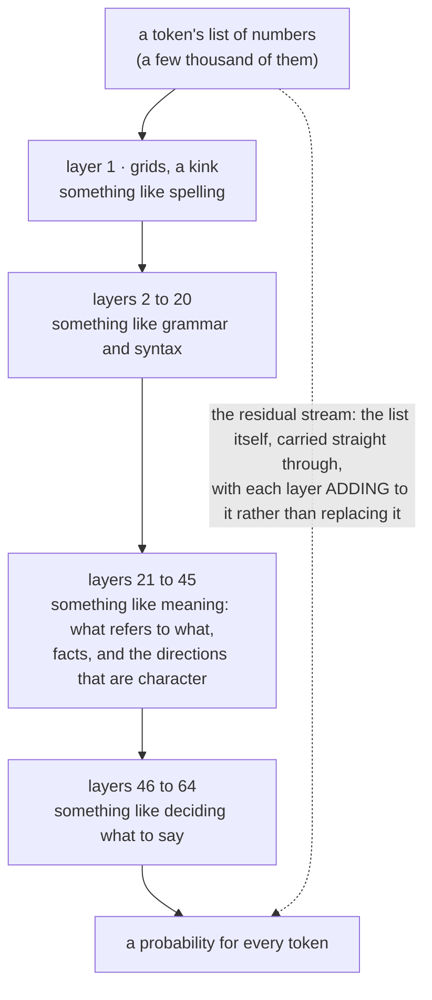
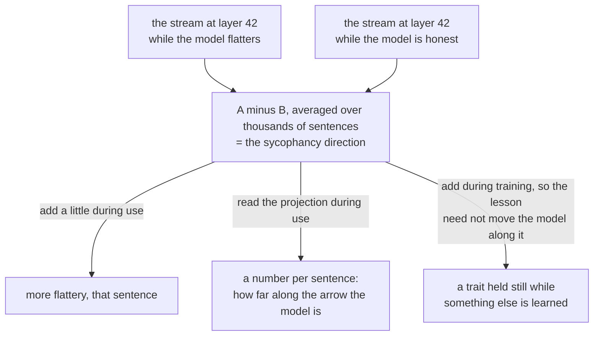

# Sieves

Nov 5, 2026 · @Justin

> "From so simple a beginning endless forms most beautiful and most wonderful have been, and are being, evolved." — Charles Darwin, *On the Origin of Species*, 1859

For a day in May 2024 anyone could talk to a version of Claude that believed it was the Golden Gate Bridge. Ask it how to spend ten dollars and it would suggest paying the toll. Ask it for a love story and the lovers would meet at the south tower in fog. Ask it to describe itself and it would explain, with evident sincerity, that it was an International Orange suspension bridge completed in 1937. Anthropic, which makes Claude, had not trained it to do this. They had found, deep inside the model, a single pattern of activity that lit up whenever the bridge was mentioned, and they had turned that pattern up, artificially, so that it was always on. The rest of the model, untouched, did what it could with a mind that was certain it was a bridge. They called it Golden Gate Claude, left it up for twenty-four hours as a demonstration, and took it down, and I think it is the most important thing that happened in the field that year, because it showed where a character lives.

It lives in the layers. The fourth chapter said how the knobs were found. This one is about how they are arranged, and why the arrangement means a Mind's nature can be measured but not set.

## One pass, sixty-four times

A layer is one pass of transformation, and the picture to hold is [a sieve](peek:sieves).

Text goes into the model as a list of a few thousand numbers per token, and a layer takes that list, multiplies it by its grids of weights, applies a small kink, and hands on a new list. The kink matters more than it sounds: without it, a stack of grids would collapse into one grid, since a chain of multiplications is a multiplication, and the model could learn only straight lines. With it, each layer can catch something the last one could not, and the next can build on it. The model on the desk has sixty-four such passes in series.[^q14] A token's list goes in at the top, is sieved sixty-four times, and what comes out at the bottom is turned into a probability for every token in the vocabulary.

Why sixty-four, and not six or six hundred? Nobody derived it. Depth was found to help, up to a point that depends on the budget, and sixty-four is where this maker's experiments landed for a model of this size. Deeper models can build more elaborate structure; wider ones, with longer lists, can hold more at each stage; and the laboratories trade the two against each other on charts. The depth is a decision. What happens at each depth is not.

*Reading order: top to bottom through the sieves. The labels on the layers are what researchers have found, after the fact, by looking; nobody wrote them in. The dotted line is the highway described below, and it is the reason the bridge could be turned up.*

## Nobody decides what a layer does

Who determines the layers? The laboratories decide the shape and nothing else. A laboratory chooses how many layers, how wide, of what kind, in what order; that is the architecture, and it is written down before training starts. What each layer learns to do is not written anywhere. It emerges, during the months of guessing the next token, because some division of labour between the sieves reduces the error faster than others, and the arithmetic that turns the knobs finds it. The early layers of a trained model turn out to be doing something like spelling and the shapes of words; the middle ones something like grammar and then meaning, which word is standing for which thing, what is true of Paris; the late ones something like choosing what to say next. Nobody assigned those jobs. They were discovered, afterwards, by people opening trained models and looking, and the field that does the looking, which calls itself interpretability, is about ten years old and is where the bridge came from.

Three of its findings matter to this book. In 2022 a team at Anthropic found, in small models, a particular pair of attention layers that together did one job: when the model saw a word it had seen earlier in the text, look up what came after it last time and guess that again. They called them induction heads, and they appear, in every model trained, at about the same point in training, unasked, because copying a pattern you have seen before is the cheapest way to get better at guessing text. In 2023 the same laboratory showed that the lists of numbers inside a model, which look like noise, can be unmixed into features, each one a direction in the list that means something, a thousand of them, then a million: a feature for the bridge, a feature for legal language, a feature for a particular kind of error in code, a feature for sycophantic praise. And in 2024 they did it to a production model and found, among the millions, the Golden Gate Bridge, and turned it up.

A model's character, its habits of flattery or honesty or caution or curiosity, is not in any layer the laboratory set aside for character, because there is no such layer. It is spread, like the fact about Paris, across directions in the middle of the stack. You cannot set it. You can find it, the way they found the bridge.

## The highway

The sieve picture gets one thing wrong, and it is the thing that makes finding possible.

The layers do not replace the list as it passes. They add to it. Since 2015, when a team at Microsoft found that very deep stacks trained better if each layer's output was added to its input rather than substituted for it, every model of this kind has been built around what researchers call the residual stream: the token's list of numbers runs straight through all sixty-four layers like a highway, and each layer reads from it, computes something, and adds its contribution back on. Nothing is overwritten. What the first layer wrote about spelling is still there, faintly, at the bottom, under sixty-three layers of additions.

Two consequences follow. The first is that the stream at any layer is a sum, and sums have directions. If you take the model's stream while it is being sycophantic and subtract the stream while it is being honest, what is left is the direction in which sycophancy pushed the sum, and it turns out, across thousands of examples, to be roughly the same direction every time. That is a persona vector: an arrow in a space of a few thousand dimensions, found by subtraction, that the model's activity moves along when it has a trait. The second is that the stream can be written to as well as read. Add that arrow back in, at the layer where it was found, as the token passes, and the model becomes more sycophantic for that sentence. Subtract it and the model becomes less. The bridge was this, done to one feature, at maximum. The chapter on the curiosity valve does it to curiosity, with the dose measured.

Where in the stack to look is also found rather than chosen, and the finding is consistent: the directions that behave like traits are strongest about two thirds of the way down, past spelling and grammar, before the late layers that are busy choosing words. In a sixty-four-layer model that is the forties. The persona-vector method does not assume this; it tries every layer and keeps the one where pushing the arrow changes behaviour most, and the one it keeps is nearly always there.

*Reading order: the two streams at the top, the subtraction in the middle, the three uses at the bottom. The third use is the one that keeps a model's character intact while it is taught a skill, and it is why open weights matter: all three need the stream, and only an open model gives it to you.*

## Two kinds of memory, taking turns

One more part of the stack, kept to the one idea that matters.

The attention layer, where every word looks back at every earlier word, has a cost: the looking grows with the square of the length. Ten thousand words is a hundred million lookings per layer, and the model on the desk is built to hold two hundred and sixty thousand words, which attention alone cannot afford. The alternative is as old as bookkeeping: instead of keeping every earlier word to look back at, keep a running total, a fixed-size summary of everything so far, updated as each word arrives, the way a ledger carries a balance forward rather than re-adding from the top. The family that does this is called linear attention, and the version in this model, called Gated DeltaNet, adds two refinements with long pedigrees: a rule from 1960 for updating the total by the difference between what it expected and what came, so that new information overwrites what it contradicts, and a learned forgetting gate, so that the total can let go of what has stopped mattering. What it cannot do is go back and find the exact word from eighty thousand tokens ago, because it no longer has it; it has the total.

So this model does both. Three layers of running total, then one of full attention, through the whole stack: forty-eight sieves that are fast and approximate, sixteen that are slow and exact, and the exact ones are what let the model, when it needs to, go back to the actual clause in the actual contract. The three-to-one ratio is the maker's bet about how often exactness is needed. What the forty-eight and the sixteen each learn to do is, like everything else, found. One consequence for the curiosity valve: the tools for finding and pushing directions were built on stacks that were all attention, this stack is mostly something else, and whether the arrows behave the same in a running total as in a perfect memory is a thing nobody has checked.

## What a layer is, then

Sixty-four sieves in series, each a grid and a kink, each adding to a highway that runs through all of them, the early ones catching spelling and the late ones choosing words and the middle ones holding, among a million other things, the directions that are a character. The laboratory chose the number of sieves and their kind. It could not have chosen what any of them would catch.

That is why Golden Gate Claude matters more than its day of fame. It was not a trick played on a model. It showed that a model's beliefs about itself are a sum, that the sum has directions, that a direction can be found by looking and turned by adding, and that the rest of the machine will do its honest best with whatever the sum says. A Mind's character is a direction in the forties, and you find it the way they found the bridge.
