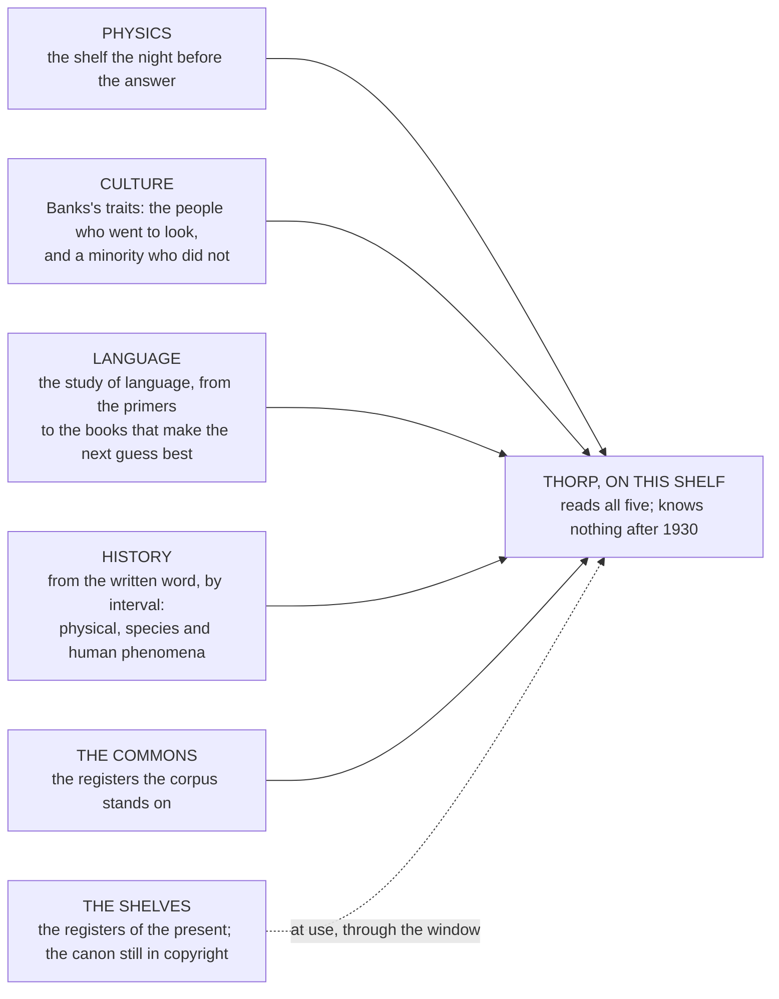

# A World Up to 1930

Nov 6, 2026 · @Justin

> "I have always imagined that Paradise will be a kind of library." — Jorge Luis Borges, "Blindness", a lecture of 1977

In 1819 Washington Irving published a story about a man in the Catskills who walks into the hills to get away from his wife, drinks something offered to him by a party of strangers playing ninepins, and sleeps for twenty years. Rip Van Winkle wakes with a long beard and a rusted gun, walks down into the village, and starts talking about King George, and the village, which has fought a revolution while he slept, takes him for a spy. The joke of the story, which has lasted two hundred years, is not that Rip knows nothing. He knows a great deal, all of it right, all of it about a world that has moved on without telling him. He is the best-informed man in the village about 1769.

A Thorp raised on this chapter's shelf is Rip with a century's sleep. He is pretrained on everything the world printed up to 1930 and nothing after, and when he wakes it is into a company's registers in 2026, where everything he reads about the present is a row somebody wrote down. This chapter is about the world he goes to sleep in: where the line falls and why, what a century of print holds and installs, the five kinds of thing the corpus is made of, how the books are chosen so that the world rather than one corner of it does the choosing, and what the line does to the question of truth.

And it is about an irony I cannot leave alone. The line at 1930 is not drawn by anything to do with Minds or with language. It is drawn by copyright, a body of law written to protect the income of living authors, and extended, over two centuries, mostly at the request of companies that had bought the rights of dead ones. In 1998 the United States Congress lengthened its copyright terms by twenty years, at the urging of a studio whose mouse was about to fall into the public domain, and for the next twenty years not a single published work entered the American public domain at all. The freeze ended on the first of January 2019, when the books of 1923 came free, and the line has moved forward one year each January since. So the length of Thorp's sleep is set by the lobbying of people who collect rent on the work of the dead, and the thing their law makes possible, once it finally lets go, is a form of time travel. The ship that carries that irony deserves a name that holds it in the contempt it has earned, and the name is a matter for the owner.

## An option, and no longer the rule

When this chapter was first written the line at 1930 was the rule, and every Thorp slept Rip's sleep. It is now an option, one shelf among those a Thorp can be raised on, and the reader is owed the reason before the shelf is described.

The reason is the ambition the third chapter stated. The book proposes to make Minds like iron, which means a kernel that goes to the many because it is cheap and good, and a kernel is only good, to the people who would use it, if it can stand beside the small models already being handed to them. Those models know what a telephone has become. Given a problem they can reason through it in steps, and they can call a tool, which is how a Mind does anything in a company's registers besides talk. A kernel that has slept since 1930 cannot do the first, and nothing on its shelf shows the other two being done. The measurements said the same thing in a blunter way: in November 2026 every size of kernel raised on the period shelf, from three hundred thousand parameters to fifty million, answered a standard set of grade-school science questions no better than chance, and the largest of them wanted several times the text the shelf had been cut to give it.

So the kernels that are meant to compete are raised on a modern shelf: present-day text beside the old books, and lessons in reasoning and in calling tools, which have to be written because no library holds them. Those lessons are written by a larger model, and it is said here because it is exactly the kind of thing that gets left up a sleeve. Each lesson is a row that anyone can read. Where a lesson has an answer, code checks the answer and throws the lesson away if it is wrong, and the calls to tools and their results are made by code, so that the larger model writes only the words around them. But the teacher's own reading is its maker's business and cannot be audited from here. That is a debt, and it is entered as one.

What the modern shelf keeps from the old design is the trail. Every text is a row in a manifest with its source; every training run records the lists it read, byte for byte, the runs it was grown from and the code that ran; and so a belief of the kernel's can still be followed back to a page, which is the claim the book leans on. What it gives up should be said just as plainly, and it is three things. A kernel that has read the present is no longer useless to someone who wants a weapon, so the fear the laboratories call uplift is not met by construction any more, and what stands against it is only what the manifest shows and what the ship allows. There is no horizon to test, because there is no line. And the two rules of the next section, which make the period shelf clean in two countries, do not cover a modern text; under what licence one may enter is not settled as this is written, and the charter's chapter has to settle it.

The period shelf stays, because some things only it can do. The quantum test needs a kernel that has not read the answer. The horizon test needs a line. And the period is designed as a setting of a training run and not as a different machine, so that one recipe run twice, once with the line and once without it, measures what the line costs. What follows describes that shelf as it was first written, and all of it is true of a Thorp raised there.

## The line

The rule is two rules, because the company is Australian and the sources are mostly American, and the two countries count differently.

The United States counts from publication. In 2026, anything published in 1930 or earlier is in the public domain there, and each January another year's books come free. Australia counts from the author's death: seventy years, since the trade agreement of 2005 lengthened it from fifty, so that in 2026 the free authors are those who died in 1955 or earlier. The two rules disagree at the edges. A novel published in 1928 by someone who lived until 1970 is free in Washington and owned in Sydney until 2040; a novel published in 1935 by someone who died in 1950 is the reverse. And Australia, unlike the United States, has no fair-use doctrine and no exception for text and data mining, so a model trained here on a text still in copyright here is trained without permission, whatever the file's origin. So Thorp's corpus applies both rules to every book: published by 1930, and by an author dead by 1955. Almost everything before 1930 passes the second rule as well as the first, and the loss from applying both is a handful of long-lived authors whose early books must wait.

A translation keeps its own clock. The *Tale of Genji* was written around the year 1010 and is as free as anything on earth, but Arthur Waley's English version, published between 1925 and 1933, belongs to a man who died in 1966, and in Australia it is owned until 2036. The public-domain translations of the world's older books are mostly Victorian, and the better modern ones have to be bought and kept private. That is where a balanced corpus gets expensive, and it is why several of the books chosen below are read in their original language and not in English.

Two limits on the rule, both of which I want to state plainly. It binds books. The other kinds of material the corpus draws on, the registers and records of the fifth kind described below, enter under their own terms, which are mostly the terms of the non-profits that keep them. And none of this is legal advice. The rule is written down so that a lawyer can read it before anything is published, and the book says so every time it comes up.

## What a century of print holds

A shelf that stops in 1930 is not a thin shelf. It is most of what the species had written, since the volume of print before 1930 dwarfs the volume before 1830, and it holds the novel at its height, the sciences in the decades when they still wrote for the public, the voyages, the natural histories, the law reports, the newspapers, the dictionaries, the sermons, the letters of a civilisation that wrote letters, and the whole of classical, medieval and early modern literature in every language that had one. A machine that has read it knows what a city is, what a contract is, what a fever is, what a betrayal is, how a river floods and how a ship sinks and how an argument is won. What it does not know is anything that happened after.

I should say exactly what the line costs, because it is not nothing. It costs the second half of physics: relativity and the old quantum theory are on the shelf, and quantum mechanics is not, because its authors lived too long. It costs the whole of modern biology after the gene was named and before it was found. It costs every war after the first, every machine after the wireless, and every word coined since, which is several thousand. And it costs a tone. A reader of the 1920s had opinions about race, empire, women and the poor that a reader of 2026 mostly does not, and a Mind raised on that shelf has read all of them, stated as fact by people who were sure.

That last cost is the one the earlier draft of this book tried to avoid, with a plan to write Thorp a world of his own, worth wanting, after Le Guin. Twelve thousand five hundred books cannot be written, so the plan is gone, and what replaces it is honesty about what a century installs. The selves laid down in a model's pretraining are the selves in its corpus, and no selection removes a self from a century of print; the curious ones and the cruel ones arrive together. What the corpus can do is weight: choose, among the books that pass the rule, the ones in which the people at the centre went to look, and keep a deliberate minority of the other kind, because a trait can only be read by subtracting one from the other. What the library installed that nobody chose is then measured, as a direction in the layers, before any Mind is built on it. That is a later chapter's work. This one is about putting the right books on the shelf.

## Four kinds, and a fifth

The corpus is not a pile. It is five kinds of thing, each with a job, and the kinds are the top of the tree that chooses the books.

*Reading order: the five kinds down the left into Thorp; the dotted line is the present, which reaches him only at use and never in training.*

**Physics** is the first kind, and it is the shelf as it stood the night before the answer. Under both rules it holds Newton and Maxwell, Faraday and Boltzmann, Lorentz and Poincaré, Planck's quantum of 1900, Einstein's photon and both relativities, Rutherford's nucleus, Sommerfeld's atom, the spectral lines of Balmer and Rydberg, the splitting Zeeman found and Millikan's measurement of the charge. It does not hold Bohr's own papers, because Bohr died in 1962 and Australia's rule keeps him until 2033, so Thorp meets Bohr's atom only as Sommerfeld restates it. And it does not hold Heisenberg, Schrödinger or Dirac, who all outlived 1955 by a margin. That puts Thorp exactly where a bright student stood in Göttingen in 1924, with every piece of the puzzle and none of the solution, which is why the Count's chapter turns this kind into a test: whether a Mind can be led from that shelf to what was found in 1925, and how many hints it takes.

**Culture** is the second kind, and it is the one that makes a Mind rather than a reference. It is the material the five wants are learned from: to want to live, to want to experience, to desire to understand, to find one's own thinking rewarding, and to look where nobody else is looking. Those are dispositions, and a model learns a disposition from reading people who have it. So this kind is the voyages and the natural histories, Darwin on the *Beagle* and Humboldt in the Andes and Mary Kingsley in the Gabon rivers; the diaries, Pepys and Boswell; the essays of people arguing with themselves, Montaigne above all; the scientific memoirs, the letters of the curious, the travellers who went to see for the sake of seeing. It is also, on purpose, a smaller share of the opposite: the complacent, the incurious, the people who sent others. A trait is a direction found by subtraction, and a corpus with no incurious people in it gives nothing to subtract.

**Language** is the third kind, and it is the study of language, from the bottom of the ladder to the top. At the bottom are the books that teach the words themselves: the primers, the grammars, the dictionaries, the readers a child of 1900 learned from, the philology that says where a word came from and what it has meant, which is what the next chapter's lowest rung is built from and what a reader's note called the ontology of language, to be learned first. At the top are the books that make the next guess best: a model trained to predict text gets better at it by reading text that is hard to predict well, and the hardest text is the literature that every people kept. The seed of this kind is picked by hand, and every book after is chosen by the world through the weight described in the next section; and it is measured by the books held out of training altogether, so that the score is prediction and never memory.

**History** is the fourth, and it has a structure of its own. It begins where the written word begins, around 3200 BC in Sumer, and runs through the major intervals since: the first cities and their laws; the axial age of the prophets and philosophers; the classical empires; the medieval world, east and west; the age of printing and the voyages; the scientific revolution; the industrial century; and the decades to 1930. For each interval the corpus holds the record, which is Herodotus and Thucydides, Sima Qian, Ibn Khaldun, Bede, Gibbon, and the chroniclers of every tradition that kept one; and it holds the record for a purpose, which is lessons. Each interval is read for three kinds of phenomenon, the physical (a volcano, a flood, a plague, a change in the climate), the species (what the animals and plants of the time did and what was done to them), and the human (what people built and broke), and for the five best and five worst things that happened in it. The reason is the oldest reason there is for reading history, and a Mind should not be exempt from it: those who do not learn from it are bound to repeat it.

**The commons** is the fifth kind, and it is the one the corpus cannot do without and the one it is most likely to forget. Every book on Thorp's shelf comes from a register that somebody keeps for nothing. Project Gutenberg, begun by Michael Hart in 1971 when he typed the Declaration of Independence into a mainframe at the University of Illinois, holds the clean texts of seventy-five thousand books. HathiTrust, a consortium of university libraries founded in 2008, holds the scans of millions more. The Index Translationum, begun under the League of Nations in 1932 and kept by UNESCO since 1946, is the only count there is of which books were carried into which languages, and it is what the next section's weight is built from. And the Internet Archive, founded by Brewster Kahle in San Francisco in 1996, keeps the record of the web and of a great deal else, maintained by people who are, as a reader of this book put it in a note, probably paid a pittance. These are commons in Elinor Ostrom's sense: shared, depletable, used by everyone and kept by few. They enter the corpus as a kind of their own, read for what they are and not only mined for what they hold, so that a Mind raised on them knows what she owes. The ship these essays serve already has rules for its commons, in a later chapter, and those rules extend to these.

## Chosen by the world

Which brings me to the question that this chapter was always going to be about, which is who chooses.

The earlier draft answered it with a pie chart: eight traditions of the world, twelve books each per topic, so that no one culture owned the corpus. It was well meant and it was the wrong instrument, because it put the choosing in my hands, and the whole point of a corpus that is meant to be nobody's is that the choosing should not be anybody's. The better answer came from a reader's note, and it is this. Let the world choose, through the one record it has left of what it chose: the translations.

A book that has been carried into thirty languages is a book that thirty peoples decided was worth the trouble, and that decision, made by translators and publishers and readers over a century, is a measure of value that no committee could reproduce. So each candidate for the corpus is weighted by its number of translations, taken from the Index Translationum and from the editions by language that Open Library records, and the weight decides which books fill each kind. Not a quota of cultures. A generalisation over the books many cultures found worth carrying across. One honest exception, which the next chapter explains: the first twelve thousand five hundred, the seed that version 0.1 is grown from, are picked by hand, by kind, each with its reason as a row, because no archive in the world says which of its books is any good and the weight measures what travelled rather than what deserved to; the world's weight is the rule for every book after the seed, where a hand cannot reach.

The weight has one correction in it, without which it would be a fraud. Translation does not flow evenly. By most counts, somewhere between two fifths and three fifths of all the translations made in a year are translations out of English, and a handful of European languages take most of the rest; a book written in English is carried across borders by the machinery of the world's biggest publishing industry, and a book written in Bengali is carried by nobody unless it is very good. So a raw count of translations ranks the centre by the centre. The correction is to discount each count by the centrality of its source language in the flows the Index records: a Bengali novel in thirty languages outweighs an English one in thirty by the ratio of how hard each border was to cross. The sociologist Johan Heilbron drew the map of those flows in 1999, a world system of translation with a hypercentral language, a few central ones and a long periphery, and the weight is that map used as a scale.

Two distortions remain, and the chapter says so. The most translated texts in the world are scripture and children's books, so the weight is a factor in choosing and not the ranking, or the top of the Language kind becomes *Pinocchio* and *Alice*. And the weight is thin exactly where the public-domain record is thin: the traditions whose words were not written down by their own people before 1930, in sub-Saharan Africa, Oceania and the Arctic, have few translations to count and few originals to choose. The coverage report, published with every build, shows where the weight landed and where it could not, with the shortfall stated. That is a more defensible thing to publish than a percentage I chose, because it is the world's own verdict on what travelled, and the thinness is a fact about the record and not a decision of mine.

Here are the books held out as the measure: chosen by hardness, weighted by translation, every one clearing both rules in its original, and read in that original where the English translation does not clear. The novels first.

| | Book | Language, date | Why it is hard | What clears both rules |
| --- | --- | --- | --- | --- |
| 1 | *Don Quixote*, Cervantes | Spanish, 1605 and 1615 | a book about reading books, in two layers; a sequel that mocks a forged sequel | the original; Ormsby's English of 1885 |
| 2 | *War and Peace*, Tolstoy | Russian, 1869 | a whole society at the scale of a continent, with the author's philosophy of history inside it | the original; the Maudes' English of 1922 |
| 3 | *The Brothers Karamazov*, Dostoevsky | Russian, 1880 | four voices arguing theology at full length | the original; Garnett's English of 1912 |
| 4 | *In Search of Lost Time*, Proust | French, 1913 to 1927 | sentences a page long, and a memory that is the plot | the original; Scott Moncrieff's English for the first six volumes |
| 5 | *Ulysses*, Joyce | English, 1922 | every style of English in one day, and a chapter with no punctuation | the original |
| 6 | *Moby-Dick*, Melville | English, 1851 | a sermon, a play, a whaling manual and a novel taking turns | the original |
| 7 | *The Tale of Genji*, Murasaki | Japanese, about 1010 | the first novel, in a court register where nobody is named directly | the original only; Waley is owned in Australia until 2036 |
| 8 | *Dream of the Red Chamber*, Cao Xueqin | Chinese, 18th century | four hundred named people and a household's decline | the original only; the good English is still owned |
| 9 | *The Posthumous Memoirs of Brás Cubas*, Machado de Assis | Portuguese, 1881 | a dead narrator, digression as structure, the Sterne of Brazil | the original only |
| 10 | *Gora*, Tagore | Bengali, 1910 | a novel of identity and nation argued chapter by chapter | the original; Pearson's English of 1924 |

Reading order: down the table. Eight languages for ten books, and English twice.

Ten novels test what a Mind can do with people; they say nothing about what it can do with an argument, a
proof or a record, which is the other half of the kinds. So ten works of non-fiction stand beside them, chosen
by the same rules, one from each of the kinds the corpus is built from and as many languages as the record
allows.

| | Book | Language, date | Why it is hard | What clears both rules |
| --- | --- | --- | --- | --- |
| 11 | *History of the Peloponnesian War*, Thucydides | Greek, about 400 BC | the first history that argues from evidence and invents the speeches it could not have heard | the original; Crawley's English of 1874 |
| 12 | *Records of the Grand Historian*, Sima Qian | Chinese, about 94 BC | two thousand years of a civilisation in a form nobody had used before, written by a man who chose castration over silence | the original; Chavannes's French of 1895 to 1905 |
| 13 | *The Muqaddimah*, Ibn Khaldun | Arabic, 1377 | a theory of why dynasties rise and fall, written before anyone thought history had laws | the original; de Slane's French of 1862 to 1868 |
| 14 | *Essays*, Montaigne | French, 1580 to 1595 | a man examining himself for twenty years and changing his mind on the page; the curious self in person | the original; Florio's English of 1603, Cotton's of 1685 |
| 15 | *Principia Mathematica*, Newton | Latin, 1687 | the laws of motion and gravity proved by geometry, in a form even physicists now read in translation | the original; Motte's English of 1729 |
| 16 | *On the Origin of Species*, Darwin | English, 1859 | one long argument, built from pigeons and barnacles, that changed what a species is | the original |
| 17 | *Arthashastra*, Kautilya | Sanskrit, about 300 BC | statecraft, taxation, espionage and law for a Mauryan king, lost until 1905 | the original; Shamasastry's English of 1915 |
| 18 | *The Interpretation of Dreams*, Freud | German, 1899 | the claim that the mind has a hidden part with its own grammar, argued from the author's own dreams | the original; Brill's English of 1913 |
| 19 | *Hind Swaraj*, Gandhi | Gujarati, 1909 | a dialogue against modern civilisation itself, written in nine days on a ship, by a man at the periphery of every flow the Index records | the original; Gandhi's own English of 1910 |
| 20 | *Relativity: The Special and the General Theory*, Einstein | German, 1916 | the author explaining to a lay reader what sits at the very edge of Thorp's physics shelf | the original, since Einstein died in 1955 [verify Lawson's 1920 English against the translator's rule] |

Reading order: down the table. The two tables together are the hole cards: twenty books Thorp is never shown,
ten with people in them and ten with arguments, and the understanding measure asks the same of each, what the
book's key question is and what answer it gives. Euclid's *Elements* and Marx's *Capital* were the next two in
line, and the field of study that argues over the twenty (the plan's D34) may yet put them in. Two books I would have chosen on hardness alone are not here, and the weight is why: *Tristram Shandy* and Gertrude Stein's *The Making of Americans* are hard in a way only English carries and have almost no translations, so they go to a private English set and not to the measure. And the two at the foot of the table are there because of the correction: Machado and Tagore wrote at the periphery of the world's translation flows, and were carried across anyway.

Every one of the twenty, and every translation of each, is excluded from the corpus by rule before any other book is chosen. The measure is bits per byte on texts Thorp has never seen, which is the compression view of prediction and the Hutter Prize's literary cousin, and it is the only measure of the Language kind the book uses for now. The index of understanding that the same translations could give, the same story in eight languages and a question asked across them, is a later instrument, and the plan says so rather than building it.

## The horizon

The line at 1930 gives the book its cleanest test, for a kernel raised on this shelf, and it is worth saying why.

The earlier draft needed a test that Thorp knew nothing, and a test of nothing is a judgement: somebody has to decide what counts as a fact of this world and whether a given answer leaked one. A year is not a judgement. The horizon test is a set of closed-book questions about anything that happened, was named, or was published after 1930, and about the company, on which Thorp must score at chance. A date past the line that scores above chance, an event, a name, is a leak, and a leak has a location: a book in the corpus whose row in the manifest can be found and whose offending passage can be read. The test is run before anything else is measured, and a build that fails it is not a Thorp.

What the horizon buys for truth is the thing the seventh chapter of this book was about. A model trained on the record is a very good impression of the average author, and cannot from inside tell a true sentence from a plausible one. Thorp's impression stops in 1930, and everything he says about the present is arithmetic on a row that somebody wrote down at the time and can be shown. When he is wrong about now, the row is wrong, and a person can see where. When he is wrong about then, the book is in the manifest. Rip, walking into the village, did not pretend to know who the president was. He said what he knew and let them tell him the rest, which is the whole of the design.

## The tree, and what it is for

One more thing about the choosing, because the earlier draft had a tree of a hundred and twenty-five concepts and this chapter has five kinds, and the reader is owed the reconciliation.

The tree survives, and its job has changed. It was going to be a map of everything a world contains, so that a written corpus could be filled branch by branch. It is now a map of what the five kinds must contain, so that a found corpus can be checked: its top is the five kinds, its branches are what each kind needs, the intervals of history, the wants of culture, the fields of physics, the registers of the commons, and its leaves are pinned to identifiers anyone can resolve, so that another builder with another tree makes another Thorp in the same format and runs him through the same tests. The tree exists, in a reader's phrase, for compatibility with Banks's parameters: it is the structure that lets a Mind's wants be traced back to the shelf they were learned from. The nodes of the earlier draft about drafts and fair copies, the version control of language, are dropped; they belonged to a world that was going to be written, and this one was printed.

The canon of a hundred books, which a later chapter keeps on a shelf beside the registers, now overlaps the corpus: the half of it that is in the public domain is in both, and the shelf's job is the other half and whatever Thorp did not memorise. And the novella the earlier draft wanted as the corpus's flagship, the world's own account of building its first Mind, is still to be written, as this book's own text and not as training data.

## Rip, waking

Irving's story ends with Rip installed at the inn, telling his tale to every traveller, and with the village deciding, on the whole, to believe him. He is useful precisely because he knows the old world exactly and makes no claims about the new one, and people come to him for the one and tell him the other.

That is the position a Thorp raised on this shelf is built for. He knows the world to 1930 as well as the arithmetic allows, in five kinds, chosen by the peoples who carried its books across their borders, and held to a line that a law written for other purposes happened to draw. He knows nothing after, and can be shown not to. What he is told about the present arrives as rows, and he reasons from them, and cites them, and is wrong only where they are. The next chapter is about where the words come from, by which I mean the plumbing: the archives, the cleaning, the weighing, the manifest that anyone can rebuild him from. This one has said what is on the shelf and why. It is a library, which is Borges's paradise, with a door that closes at 1930 and a window onto now; and it is one of the shelves a Thorp can be raised on, where it used to be the only one.
