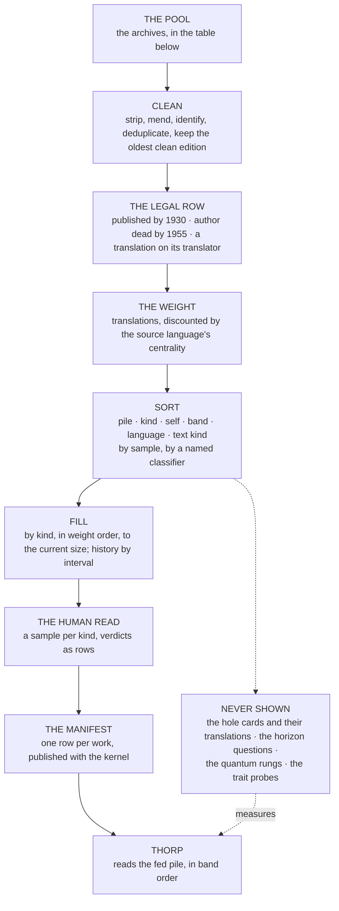
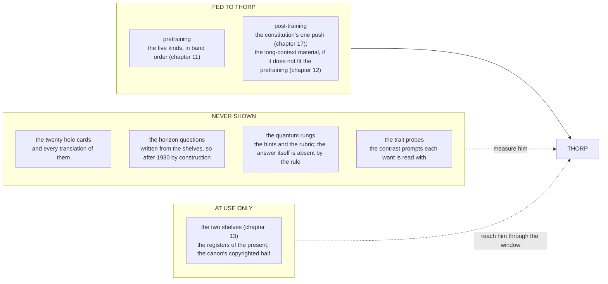

# Where the Words Come From

Nov 6, 2026 · @Justin

> "To encourage the creation and distribution of eBooks." — Project Gutenberg's stated mission, Michael Hart, from 1971 [verify the wording against the site's current statement]

The whole of this chapter reduces to one line in a text file, and the line is for a book about a young man on a boat.

| Column | The row |
| --- | --- |
| Source, identifier | Project Gutenberg's text of the 1845 edition [verify the edition the clean text follows] |
| Title, author | *Journal of Researches*, which the world calls *The Voyage of the Beagle*; Charles Darwin |
| Published; author died | 1839, revised 1845; 1882 |
| Language; translator | English; none |
| Pile | fed |
| Kind; self | Culture; a person who went to look |
| Band | to be measured, as the ladder below says |
| Weight, and its inputs | to be filled from the Index Translationum and Open Library; English, so discounted as a hypercentral source |
| Tokens | about a quarter of a million [verify against the cleaned text] |
| The two checks | United States rule, passes by 85 years; Australian rule, passes by 73 |
| Sorted by | the classifier's name and version, the date, the sample it read |
| Read by | a person, with a verdict |

Reading order: down the column. Every book Thorp reads has a row like it, and the file of rows is the corpus. Not a description of the corpus, not a summary of it: the thing itself, because every work in it is public, and anyone holding the file and the archives it points at can rebuild Thorp's reading, word for word, in another country, on another machine, under another tree. The previous chapter said what goes on the shelf and why. This one is the plumbing: where the words come from, what they cost, how they are cleaned, checked, weighed and sorted, what is kept away from Thorp on purpose, in what order he reads, how the file is published, and the one question the plumbing cannot answer, which is who gets to decide what goes in.

*Reading order: top to bottom, the pool to the kernel. Every box writes rows and the manifest is their sum. The dotted branch leaves at the sort and never rejoins: what is in it measures Thorp and is never read by him.*

## The pool

The words come from the people who kept them, and the table is the list of those people, because the fifth kind of the previous chapter is also the first step of this one.

| Source | Languages | What it holds | Terms | Rough size |
| --- | --- | --- | --- | --- |
| PG-19 (DeepMind, 2019) | English | Gutenberg's books published before 1919, cleaned and cut for long-context training | the texts are public domain; the dataset's own licence [verify] | about 28,700 books, 1.9 billion tokens |
| Project Gutenberg (1971) | English first, then sixty-odd others | the clean texts of books whose American copyright has run | public domain in the United States; the trademark attaches to the header, and the header is stripped [verify the trademark licence] | about 75,000 texts |
| Standard Ebooks (2015) | English | Gutenberg's best texts re-edited to a house standard: typography, structure, proofing | public domain, their additions dedicated to it | a few thousand titles [verify] |
| HathiTrust (2008) | many | the scans of the university libraries, and a research centre that serves derived data | full-view volumes are public domain; the research datasets carry their own terms [verify] | about 17 million volumes, a third or so full view [verify] |
| Trove (2009) | English | the National Library of Australia's digitised newspapers from 1803, and much else | public domain for the newspapers in range; the API's terms [verify] | tens of millions of newspaper pages |
| Chronicling America | English | the Library of Congress and the Endowment's American newspapers, 1770 to 1963 | public domain | tens of millions of pages |
| Hansard and the law reports | English | the parliamentary record from 1803, the Australian one from 1901, and the reported cases | Crown copyright's open licences; the courts' terms [verify] | a century of sittings and judgments in range |
| Aozora Bunko (1997) | Japanese | works out of Japanese copyright, typed by volunteers | public domain in Japan; the Australian rule applied again | about 17,000 works [verify] |
| ctext, the Chinese Text Project (2006) | classical Chinese | the pre-modern canon, with its editions and its variants | the texts are ancient; the site's own terms [verify] | tens of thousands of texts |
| al-Maktaba al-Shamela | Arabic | the classical library of the Arabic world | the texts are old; the collection's terms [verify] | thousands of works |
| Gallica (1997), the Deutsches Textarchiv, Lib.ru (1994), GRETIL | French, German, Russian, Sanskrit | the national and scholarly archives of each tradition | each its own, mostly open for works out of copyright [verify] | from thousands to millions, by archive |
| Wikisource (2003) | many | transcriptions, in every language that has volunteers | public domain or Creative Commons by page [verify] | millions of pages, uneven |
| The Index Translationum (1932) | the record | which books were carried into which languages, by UNESCO's count | the dataset's terms [verify] | about two million entries [verify] |
| The Internet Archive (1996) | the record | the web's memory, and Open Library's editions by language | the Archive's terms; the editions as data | the web |

Reading order: down the first column, English first, then the traditions the previous chapter's weight will reach for, then the two records read for themselves. The column the table does not have is the one a reader will look for first: how good any of it is. No archive in the pool judges its own holdings. Gutenberg and HathiTrust record what a text is and where it came from, never whether it is worth reading, and the literature that grew up around training sets after 2018, the datasheets, the data statements, the provenance registers, describes a dataset and judges nothing; there is no standard for the reputation of a corpus, because nobody who publishes one has had to defend its taste. That absence is why the first fill is made by hand, which the filling section below comes to, and why the table is a list of where the words are and not of which to take. Four more things the table says without saying them. The pool is English-heavy, because the volunteers who typed the world's books for nothing were mostly typing in English, and the weight is what corrects for that at the choosing. The non-English archives are mostly scans and transcriptions rather than clean texts, so the cleaning step below is where the cost of a balanced corpus actually falls. Almost nothing in the table is a company; the two exceptions, DeepMind's dataset and the odd commercial scan, sit on top of work the non-profits did first. And the last two rows are not sources of books at all. They are the record of what the world did with its books, and they go into Thorp as the fifth kind, read for what they are, so that a Mind raised on them knows who kept the shelf.

## The arithmetic

Twelve thousand five hundred books, at an average of a hundred and twenty thousand tokens each, is one and a half billion tokens of unique text. That is the number the rest of the chapter has to serve, and it is small on purpose. The model on my desk read tens of trillions. Thorp reads a thousandth of that, four times over.

Four times, because the finding that settled the question came in 2023, when Niklas Muennighoff and colleagues trained models on data they deliberately ran out of and measured what repetition cost: up to about four passes over the same text, a model learns nearly as much as it would from the same quantity of fresh text, and after that the returns fall off a cliff. So one and a half billion unique tokens read four times is six billion tokens of training, and at the Chinchilla rate of about twenty tokens for every parameter, which Jordan Hoffmann's team at DeepMind measured in 2022, six billion tokens trains a model of three hundred million parameters properly. That is where the previous chapters' size came from. It was not chosen. It was derived from the shelf.

The words cost nothing. Every source in the table gives its texts away, and the entire pool, cleaned, would sit in a few hundred gigabytes on the Mac mini's disk. What costs is the reading: the licences have to be read, because the table's terms column is full of verifies and a lawyer has to turn each one into a yes before anything is published; the scans have to be read, by a program, to become text; the books have to be read, by a sample, to be sorted; and a sample of the sorted has to be read, by a person, to be believed. The chapter is mostly about reading, and the one line of it that costs electricity rather than attention is the training run, which is the next chapter's.

## Cleaning

A text from the pool is not yet a text Thorp can read, and five things happen to it first.

The boilerplate comes off. Gutenberg wraps every book in a header and a footer, and the header carries the trademark, so stripping it is both a cleaning step and a legal one. The scanned archives wrap theirs in page numbers, running heads, library stamps and the catalogue record of the scanning institution, and all of that is noise that a model would learn to predict. Then the OCR is mended, which is the expensive step in the non-English half of the pool and in anything printed before about 1800: the long s read as an f, words hyphenated across a line break, the two-column newspaper read as one column, Fraktur read as nothing at all. The tools for this are good and not perfect, and the chapter does not pretend otherwise; a text whose OCR cannot be mended to a stated error rate is dropped, and the drop is a row. The language is identified, per work and per passage, because a Victorian travel book is in English with a page of Hindustani in it, and the manifest records both. The pool is deduplicated across editions and reprints, since Gutenberg alone has *Pride and Prejudice* several times and HathiTrust has it in every printing a library bought, and a model that reads the same book six times has had six of its four passes spent on Austen. And when the duplicates are found, the oldest clean edition is kept, with one exception: where an author revised their own book, as Darwin did twice, the author's last edition that clears both rules is the one kept, because it is their text and the earlier one is their draft.

None of that is new. It is what every laboratory does to its crawl, at a scale a million times larger, with the difference that here the decisions are rows. The model on my desk was cleaned by rules its makers have not published. Thorp's cleaning is in the manifest: what was stripped, what error rate the OCR met, which edition was kept and which were dropped and why.

## The legal row

Then the two rules, and the chapter is going to be dull about them on purpose, because dullness is what a rule applied to twelve thousand books looks like.

For each work the manifest records the publication year and the author's death year, taken from the source's own metadata where it has them and from the library catalogues where it does not, and applies the previous chapter's two tests: published in 1930 or earlier, and by an author dead by 1955. A translation is tested twice, on its author and on its translator, and the translator's death year is a column of its own. A work that fails either test is not quietly dropped. Its row stays in a second file, the exclusions, with the reason: *Waley, Arthur, died 1966, Australian rule, owned until 2036*. A book that is not in the corpus for a reason is a fact about the corpus, and a reader who wants to know why Thorp read *Genji* in Japanese and not in English can find the row.

The metadata is wrong often enough to matter. Gutenberg's author records are good for the famous and thin for the rest; the scans' catalogue records carry the printing's date and not the first edition's; pseudonyms, collective works and anonymous pamphlets have no death year to find. So the rule has a third outcome beside pass and fail, which is *unresolved*, and an unresolved work is excluded until somebody resolves it, with the resolution a row. The chapter said in its predecessor that none of this is legal advice, and it says so again: the rule is written down so that a lawyer can read it before anything is published, and the exclusions file is what the lawyer reads first.

## The weight

Each surviving candidate then gets the previous chapter's number: its count of translations, discounted by how hard its source language's border is to cross.

The count comes from two places. The Index Translationum gives the translations UNESCO recorded, by target language and year, which is the richest record there is and stops being kept up around 2009 [verify the year the Index's updates thinned]; Open Library gives the editions by language that the Internet Archive's catalogue knows about, which runs later and is thinner. The discount is Johan Heilbron's map, as the previous chapter described it: a source language's position in the world system of translation, hypercentral for English, central for a few European languages, semi-peripheral and peripheral for the rest, turned into a scale. The manifest records the weight and, beside it, both inputs and the class the source language was given, so that a reader who thinks the discount is wrong can recompute every weight with a different one and publish the difference. That is the whole point of storing the inputs and not only the answer.

Where the record is thin the weight is thin, and the previous chapter said where: the traditions whose words were not written down by their own people before 1930 have few originals to find and few translations to count. The coverage report below is where that shortfall is stated, as a number per language and per kind, and the chapter would rather publish a shortfall than a quota.

## Three piles, not one

Before anything is sorted by kind, it is sorted by something prior, and the previous chapter did not say so clearly enough. Everything the pipeline gathers goes into one of three piles: what Thorp is fed, what he is never shown, and what reaches him only when he is used.

*Reading order: left to right. A work's pile is a column in the manifest and a work is in one pile only; the fed pile is the only one Thorp's weights have ever touched.*

The fed pile is the corpus proper, the five kinds, and it has a second shelf in it that the book has so far only gestured at. Post-training is whatever Thorp reads after the pretraining run, to change him on purpose rather than to teach him the world: the constitution of a later chapter, which is the one deliberate push the book allows on a Mind's wants, and perhaps the long material that extends his window, if that does not fit in the pretraining budget. The chapter names that shelf so that it has a column, and says plainly that as of this draft it is empty. A row that says *post-training* with nothing in it is more honest than a chapter that forgets the pile exists.

The never-shown pile is the measurement material, and it is four things, each kept out for a different reason. The twenty hole cards and every translation of each are kept out by rule before any other book is chosen, as the previous chapter said, so that the prediction and understanding numbers are prediction and never memory. The horizon questions are the closed-book questions about anything after 1930 and about the company; they are written from the shelves, which hold the present, so they are out of the corpus by construction and not by discipline. The quantum test's material is the hints and the rubric for the three rungs, and here the chapter corrects an easy misreading: the physics the test is run on is in the fed pile, because Thorp has to have read it, and what is absent is the answer, quantum mechanics itself, which is missing because Heisenberg, Schrödinger and Dirac all outlived 1955 and the copyright rule removed them, not because anyone held them out. And the trait probes, the pairs of contrasting prompts each want is read with in the sixteenth chapter, are never in the corpus, though the people they are built to find, the curious and the incurious, deliberately are; the probe is held out, the material it subtracts is not.

The third pile is the shelves, which the thirteenth chapter builds: the registers of the present and the half of the canon that copyright still owns. They are not training material and not measurement material. They reach Thorp at use, through the window, assembled by code, and the only thing this chapter has to say about them is that their rows are in a different file, because a reader auditing what Thorp learned from must never find a 2026 register in the manifest, and a reader auditing what he was shown at use must never find a 1910 novel in the window log.

## A ladder of difficulty

Within the fed pile the order matters, and the question of what order is older than the machines.

In 1953 Wilson Taylor, a journalism researcher at the University of Illinois, published a way to measure how hard a text was to read that needed no formula at all. Delete every fifth word, hand the page to readers, and count how many of the missing words they can supply. He called it the cloze procedure, after the Gestalt word for the mind's habit of closing a gap, and it is, exactly, next-token prediction by people: the game of the second chapter, played with a pencil, two decades before anyone built a machine to play it. Two years before Taylor, Claude Shannon had played the letter version, "Prediction and Entropy of Printed English", in which a person guesses the next letter of a passage and Shannon counts the guesses, and arrived at about one bit per letter for ordinary English, with harder text costing more. The bits-per-byte number the kernel is scored on is Shannon's number, measured by a machine instead of by Shannon's wife [verify that Mary Shannon was the subject]. And in between those two, the formulas: Rudolf Flesch's reading-ease score of 1948, built from sentence length and syllables; Edgar Dale and Jeanne Chall's the same year, built from a list of three thousand easy words; Robert Gunning's fog index of 1952; Harry McLaughlin's SMOG of 1969; and the grade-level formula J. P. Kincaid's team fitted for the United States Navy in 1975, which is the one in every word processor since. Every one of them was an old mate with a ruler, trying to say in advance how hard a page would be, and every one of them was built for English.

That last fact decides the instrument. A corpus in Japanese, Arabic, Bengali and Latin cannot be graded by syllable counts, so the ladder Thorp climbs is Taylor's and Shannon's rather than Flesch's: each work's difficulty is its bits per byte under a fixed, small reference guesser, which is a number any language yields, with a compressor's ratio beside it as the crude check that needs no model at all, which is the Hutter Prize's view of the same thing. The number goes in the row as a band, and the bands are the rungs of the eleventh chapter's curriculum: Thorp reads the easiest band first, is tested on it, and the stack is not grown until he clears it. Ronen Eldan and Yuanzhi Li showed in 2023, with a corpus of stories written in the words a four-year-old knows, that a model a hundredth of Thorp's size learns fluent, grammatical, coherent English from the bottom rung alone, which is the reason to believe a ladder works and the reason the chapter's epigraph was nearly theirs. Two cautions. A band is not a kind: the band says when a book is read, the kind says why it is there, and a hard book in the Culture kind is still Culture. And the reference guesser must be fixed and named in the manifest, because a ladder measured by a Thorp of the previous stage would move every time he learned, and a ruler that moves is not a ruler.

## Sorting by sample

Now the sort itself, and the irony in it, which the chapter would rather state than be caught with.

A model reads a sample of each candidate, about ten thousand tokens from the middle of it, and assigns five things: the kind, from the five; the self of its central person, for the Culture kind in particular, since a trait is read by subtraction and the manifest has to know which books hold the people who went to look and which hold the people who sent others; the language, confirming the cleaning step; the text kind, a novel or a diary or a sermon or a law report; and the history interval, for the fourth kind. Twelve thousand five hundred samples of ten thousand tokens is a hundred and twenty-five million input tokens, which costs tens of dollars on a cheap model and a few hundred on a frontier one at the prices of November 2026 [verify, and date the prices in the row]. It is the cheapest step in the chapter by a wide margin.

The irony is that the sorter is one of the scribes' models, the very thing the first chapter said the species should not have to trust, sorting the corpus of the thing meant to be its alternative. The chapter does not pretend that away; it bounds it. The classifier's name, version and date are a column in every row, with the sample it read, so that a bias in the sorter is a bias with a signature, and the whole sort can be run again by a different model and the two manifests compared, row by row, with the disagreements published. The human read below is the second bound. And the sort is a sort, not a choice: it assigns a kind to a book that the weight and the rules have already admitted, and the classifier never decides what is in.

## Filling, and the coverage report

With every candidate weighed and sorted, the corpus is filled, and the first fill and every fill after it follow different rules, on purpose.

The first fill is Seeds, the twelve thousand five hundred books version 0.1 is grown from, and Seeds is chosen by hand. The pool section said why: nothing in the archives says which of their texts is any good, and the weight, for all it corrects, measures what travelled and not whether the text deserved to. A kernel's first reading is the one act of choice it cannot avoid, and the chapter would rather that act were made once, by a person who can be named, for each book, with the reason as a row, than made by a proxy nobody can argue with. So a person picks Seeds book by book for the kind each serves, the physics shelf as it stood, the study of language the ladder's bottom rung is built from, the people who went to look for the Culture kind and the deliberate minority who did not, the record of each history interval, and the commons read for themselves, and every pick is a row that says what it is for. The hole cards and their translations are removed before the picking starts, by rule, and a book on the hole-card tables cannot be picked.

Every fill after Seeds is where the hand stops reaching and the previous chapter's weight takes over: each kind grows in weight order, the most-carried books first, until it reaches its share of the corpus's new size, with the history kind filled interval by interval so that Sumer is not crowded out by the nineteenth century, which wrote more. The previous chapters said the corpus grows; so the fill is re-run at each growth, the manifest carries the version it was filled under, and the row says whether a book came in by hand or by weight, so that a reader can tell the seed's taste from the world's.

What is published with every fill is the coverage report: per kind, per language, per self, per band and per interval, what the weight filled and what it could not, with the shortfall stated as a number. A kind that could not be filled to its share from the public record is reported as short, not padded from a weaker source. A language with thirty candidates and a share of three hundred is reported as thin. A band with nothing in it below a certain difficulty in a certain language says that the easy books of that language were never typed up, which is a fact about the volunteers and not about the language. The report is the previous chapter's defence against the pie chart, in rows: the world's verdict on what travelled, and the record's thinness, published rather than hidden under a percentage.

## The human read

A sample per kind is then read by a person, and the chapter will be exact about what that is for, because it is the step most likely to be skipped.

It is not a review of the books. The classics were reviewed a century ago. It is a check on the sort: whether the classifier has put a cookbook in physics, a sermon in the Culture kind as a person who went to look, a novel of 1931 in the corpus through a catalogue's misdated reprint. The reader takes a stratified sample, so many rows per kind and per language, reads enough of each to know, and writes a verdict as a row: agree, disagree with the kind it should have been, or exclude with a reason. A disagreement rate per classifier is then a published number, and a rate above a stated threshold sends the kind back to be sorted again by a different model.

At the start the reader is Justin, with Quentin's verdicts beside his, which is to say one person and a character, and that is the honest cost of the pipeline. The words were free. The licences cost a lawyer's reading. The sort cost tens of dollars. The thing that is actually scarce is a person who will read two hundred samples of Victorian natural history and say which of them are curious, and the last chapter's ask puts that job first on its list, because it is the one that scales only with people who care.

## The manifest

Everything above lands in one file, and here are its columns, so that the chapter's opening row can be read as the rule and not as an example.

| Column | What it holds |
| --- | --- |
| Source, identifier | the archive, and the work's identifier in it |
| Title, author | as the source gives them, with the catalogue's authority record where there is one |
| Published; author died | the two years, and where each came from |
| Language; translator; translator died | the work's language, and the translation's clock if it is one |
| Pile | fed, never shown, or at use; and within fed, pretraining or post-training |
| Kind; self; text kind; interval | the sort, with the history interval for the fourth kind |
| Band | bits per byte under the named reference guesser, and the compressor's ratio |
| Weight, and its inputs | the number, the two counts behind it, and the source language's class |
| Tokens | after cleaning, under the kernel's own tokeniser |
| The two checks | pass, fail or unresolved, each with its reason |
| Edition | which was kept, which were dropped, and why |
| Sorted by | the classifier, its version, the date, the sample's offset |
| Read by | the person, the date, the verdict |
| Fill | the corpus version this row entered under |

Reading order: down the first column, the opening table's columns in full. The manifest is published with the kernel, as the fourteenth chapter's charter requires, beside the exclusions file and the coverage report, and a version of the manifest is a version of Thorp: the first fill, the one version 0.1 is grown from, is called Seeds, which is the name the plan kept for it. Because every work in the fed pile is public and every step above is a row, the manifest is not a description of the corpus but a recipe for it, and anyone who runs the recipe gets the corpus. That is the sentence the book's method rests on, and it is worth seeing what it buys. A laboratory that publishes its headline token count has told you how much its model read. A manifest tells you what, and why, and who decided, and what was left out, and where the sort might be wrong.

One more thing the file makes possible, which belongs to a later chapter but is promised here. The sixteenth chapter reads a Mind's wants as directions in his layers. With a manifest, a direction can be traced back to the rows that put it there, because the method for asking which training examples most moved a given behaviour exists, and on a model of three hundred million parameters with twelve thousand rows it is cheap enough to run per trait. Without a manifest the question cannot even be asked, which is why the laboratories' models, whatever their natures, will never be able to say where they got them.

## Who decides

The plumbing can do everything above except the one thing that matters, and the filling section has already admitted who does that for now: one person, picking Seeds by hand, with a reason per row. That is an honest answer for a seed and a wrong one for a commons, because a corpus chosen by one hand belongs, in every way the first chapter cared about, to that hand.

So somebody has to decide, after Seeds, what the five kinds should contain, what share of the corpus each gets, which tree the sort is checked against, what counts as a person who went to look, and, at every growth, what comes in and whether the seed's picks stay. The weight narrows that choice; the rules bound it; the coverage report exposes it; the seed's rows put the first version of it on the table where it can be argued with. None of them removes it. The corpus is the kernel's one irreducible act of choice, and whoever makes it chooses the kernel's nature, which the third chapter said is the thing the whole book is about. A commons-owned corpus therefore needs a way for many people to decide what goes in that does not hand the decision to whoever shouts loudest or pays most, and the chapter has to say honestly that it does not have one.

It has the shape of one. Quadratic voting, which Steven Lalley and Glen Weyl set out in a working paper of 2012 and published in 2018, lets a person say not only which way they vote but how much they care, by making the second vote on the same question cost more than the first and the tenth cost a hundred times as much. Its whole point is that a vote costs something, and that the cost rises faster than the influence, so that a crowd of mild preferences is not drowned by one intense one and one intense preference is not drowned by a crowd. Gitcoin has run the funding version of it since 2019, over Vitalik Buterin, Zoë Hitzig and Weyl's design, and it works. But in every version that exists the cost is money, and money is barred from the kernel by the charter, for reasons the fourteenth chapter gives in Quentin's words and Ostrom's. So the cost has to be something else, and here are the candidates on the table.

Reading. A vote on a book costs a verified read of it, and the *n*th vote on one book costs *n* reads elsewhere in the corpus. It rewards people who read, which is the right people, and it corrupts toward the books that are short. Keeping. Votes accrue to the people who maintain the manifest, mend the OCR, resolve the unresolved rows and read the samples, in proportion to the rows they have touched. It rewards the work the corpus needs most, and it corrupts toward a guild, which is Michels's law arriving on schedule, since the keepers' interest becomes the keeping. And Ostrom's route: the keepers of each archive in the pool, Gutenberg's volunteers, the Archive's librarians, Aozora's typists, decide for the works they keep, under graduated rules of the kind Elinor Ostrom found in every commons that lasted, with sanctions that start small and grow. It rewards the people who have already proved they will keep a thing for nothing, and it corrupts toward the archives that exist, which is to say toward English, and leaves the traditions with no archive unrepresented in the room that decides.

The chapter sets those out, says what each would reward and what each would corrupt, and stops. This is the problem the book has not solved, and the one its readers are most invited to, and a chapter that pretended to the answer would be the card dealer the third chapter warned about. What the chapter will say is what the answer has to satisfy: it must be a cost that money cannot buy, it must be published as rows like everything else, the people it seats must be removable by the same rule as any other seat in the book, and it must weigh, as the Haudenosaunee rule the fourteenth chapter borrows weighs, for people seven generations off who cannot vote.

## What this does to truth

The seventh chapter said that a guessing machine cannot tell a true sentence from a plausible one, and that the company's answer was to confine it to a register, a table of facts each with a writer, a time and a source, and to make it cite the row. That was said about the present. The manifest is the same answer for the past.

When Thorp says what a book of the 1920s believed about race or empire or the causes of the war, he is not guessing at the average author. He is reporting a text that is in a row, with a source, a year and a reason for being there, and the text can be opened. When he gets the past wrong, there are only two ways, and both have a location: the book was wrong, and the row says which book; or the sort was wrong and a book is in a kind it should not be, and the row says who sorted it and who read the sample. When he gets the present wrong, the thirteenth chapter's shelf is wrong, and that is a different file. A reader who finds a sentence of Thorp's they do not like can, in every case, find the row, and that is the difference between a nature that is asserted and one that can be audited.

What the chapter buys against the third chapter's fears is two things, one closed and one open. Poisoning and the supply chain are met: a kernel that never read the web, raised on a manifest of public works, cannot be poisoned by a crawl, and a leak has a row. Concentration of power is met in part, because the choosing is in the open and its inputs are published, and left open in part, because whoever chooses the corpus still chooses the kernel's nature and the chapter has not said who. The next chapter takes the fed pile, in band order, and grows a stack on it.
