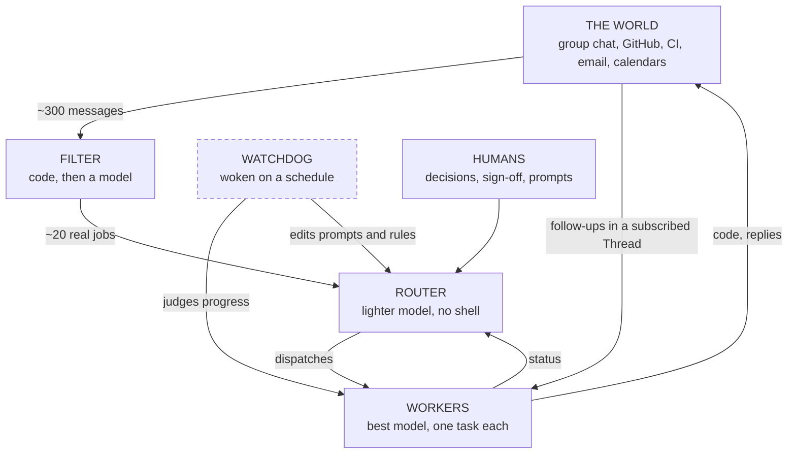

# The Thing That Runs the Thing

Nov 4, 2026 · @Justin · revised Nov 6, 2026

> "The purpose of a system is what it does." — Stafford Beer, 2001

Sometime around 270 BC, a Greek barber's son named Ktesibios had a problem with [a water clock](peek:water-clock). Water clocks keep time only if the water drips at a steady rate, and water drips at a steady rate only if the level in the tank stays put, which it declines to do. So Ktesibios put a float in the tank. When the level fell, the float fell and opened a valve. When the level rose, the float rose and shut it. Nobody had to stand there. The tank looked after itself, and if you have a toilet cistern you own a descendant of the idea, although you have probably never thanked it.

That float is the whole of control theory in miniature. You decide what you want, you measure what you have, and you use the difference to push things back. Everything since has been footnotes, admittedly some of them written by James Clerk Maxwell, who in 1868 published a paper called "On Governors" because the governors on steam engines had developed the alarming habit of wobbling in ever larger swings until something expensive came apart. Engineers had been curing this by fiddling. Maxwell cured it with differential equations, which is a thing only Maxwell would think of as a cure.

There is a small etymological joy here. When Norbert Wiener needed a name for the science of control in 1948, he went to the Greek for steersman, *kybernetes*, and came back with cybernetics. He was perfectly aware that the Latin version of the same word had already wandered into English as "governor". So [the brass device on Watt's engine](peek:governor), the person who runs Queensland, and the entire field of cybernetics are all, linguistically speaking, a bloke holding a tiller.

I mention all this because on 1 November the DeepSeek Harness team published a long essay about what they call a [Super-agent](https://x.com/DeepSeekHarness/status/2116857257245987236), written by Yujia Qiao and viewed nearly three million times. It mentions a control loop only when it reaches its Watchdog, and never uses the phrase control theory. It says on its way out that it is proposing no new theory, only classic ideas from computer systems. That is true, and it is also a bit like describing a float valve in terms of plumbing. The Super-agent is a control system, and it has walked, I suspect without quite meaning to, into a very old argument about who is supposed to be holding the tiller.

## Three to five

The number the whole essay turns on is small and slightly embarrassing. A person, the authors report, can usually follow three to five active agent sessions at once. After that we start losing track of which window knows what, and the machines, which do not get tired, sit waiting for us to come back from wherever our attention has wandered off to.

Their remedy has two layers. On top sits the Router, one long-lived session that talks to all the humans, remembers everything and dispatches work, and which by design does none of the work itself. It can run without a shell at all. Below it sit the Workers, one per task, each sealed in its own context, never permitted to speak to a human, and reporting only upward. Events from group chats, GitHub, email and calendars arrive as Triggers. A strand of code throws out most of them before any model is consulted, a model judges the rest, and an independent session called the Watchdog wakes on a schedule to check that the whole contraption is still doing what it was asked.

Here it is as a loop. Start at the world, go down the left column to the Router, across to the Workers and back up to the world. The Watchdog stands outside. The message counts come from one of their test runs.

Now, there is a joke in that diagram and I do not think it is intentional. The authors find that the Router's job is easier than expected and a lighter model will usually do, while the Workers need the most capable models available. They have, in other words, independently rediscovered the org chart: the cleverest people at the bottom doing the actual work, and at the top a cheaper unit whose main skills are remembering who everyone is and answering messages.

The nicest piece of control in the essay is one the authors present as a throughput trick. Events that arrive while the Router is thinking queue up and get merged into its next turn. In their stress test, raising the arrival rate from about 1 to about 40 decisions a minute pushed the average batch from 1.0 to 2.8, while the inference time per decision fell from 6.4 seconds to 1.6. Run the sum and 1.6 seconds a decision is about 37 a minute, which is near enough the rate arriving, and I doubt that is a coincidence. A backlog makes the batch bigger, a bigger batch makes each decision cheaper, and cheaper decisions eat the backlog. That is negative feedback with no controller in it, the same float in the same tank, and it holds until the context runs out or the model starts muddling the batch. The arithmetic is mine rather than theirs, and the workloads were synthetic; the authors say plainly that the figures are only indicative, which is more than most people in this industry say about anything.

The Watchdog is the more ambitious idea, and it has a wonderful ancestor. In 1948 a British psychiatrist named W. Ross Ashby, working at a mental hospital in Gloucester, wired together four surplus RAF bomb-control units and called the result the Homeostat. Disturb it and it would hunt about, resetting its own circuits at random until its needles settled down again. Ashby's point, set out in *Design for a Brain*, was that adaptive systems need two loops. The first keeps things steady. The second watches the first and changes its settings when steady stops being good enough. The Watchdog is that second loop: it repairs what it finds, and maintainers can have it edit prompts and trigger rules while the system runs.

What separates it from the Homeostat, and from every governor ever bolted to an engine, is what it measures. A process monitor asks if the thing is alive. The Watchdog asks if a Worker is making substantive progress or drifting from the goal, and it has to ask a language model, because nothing else can read the answer. So the sensor is made of the same stuff as the thing being sensed, and the set point is a paragraph of English. Maxwell would have wanted a word.

It gets odder when you reach the essay's section on security. A thermostat cannot be talked into anything. The Super-agent reads its instructions and its measurements as text through the same aperture, so a hostile message in a group chat is a false reading from the sensor and possibly a new order for the controller at the same moment. Telephone engineers met this in the 1960s, when a toy whistle from a cereal box could seize a long-distance line, and the cure took the phone company decades and a separate wire, which is a story for a later chapter. DeepSeek list untrusted input among their open problems, and they are right to. As far as I know, nobody has yet found the separate channel for an agent whose job is to read the chat.

## The brain of the firm

Which brings us to Stafford Beer, who would have read the Super-agent essay with a cigar going and a great many notes.

Beer was a Londoner, born in 1926, who ran operational research in the British steel industry, wrote prodigiously, and was fond of cigars, whisky and his Rolls-Royce. In 1972, in *Brain of the Firm*, he set out his Viable System Model: the claim that anything able to survive on its own, whether a cell, a company or a country, has the same five functions, and that if one is missing you can predict where it will fail. In mid-1971 a young Chilean official named Fernando Flores had approached him about trying his ideas on Salvador Allende's economy, and Beer went.

The result was Project Cybersyn. There was a national network of telex machines, usually said to be 500 although some sources think fewer, feeding factory figures into a single mainframe and a statistical program called Cyberstride. And there was [the Opsroom](peek:opsroom), a hexagonal fibreglass chamber in Santiago with seven white swivel chairs, designed by a team under Gui Bonsiepe, which looks in photographs like the bridge of a starship commissioned by a Scandinavian furniture company. Beer banned keyboards. The chairs had large buttons in one armrest and, in the other, an ashtray and a holder for a glass of whisky, an item of the specification I would like to see in more enterprise software.

The model maps onto DeepSeek's design with a closeness that I find slightly unnerving, since the essay never mentions him. The mapping below is mine.

| Beer's system | What it does | In the Super-agent | Fit |
| --- | --- | --- | --- |
| System 1 | The work itself, in units that can each stand alone | Workers, which may contain their own subagents | Good on structure, but a Worker cannot survive alone |
| System 2 | Stops the units oscillating, like a school timetable | Thread subscriptions: Workers on one pull request see the same events | Excellent |
| System 3 | Runs the present: resources, rules, allocation | The Router | Good |
| System 4 | Looks outward and ahead, models what is coming | Trigger filtering, plus acting ahead on signals | Thin |
| System 5 | Policy and identity: what this thing is for | Humans, by prompt and by sign-off | Outside the machine |

System 2 is the one that made me sit up. It is neither command nor management, only the damping of conflict between peers, and organisations constantly mistake it for one or the other. DeepSeek's Workers, finding themselves in the same pull request, get the same events and sort it out, and the Router is troubled only when they cannot. Here is the function Beer spent decades explaining to executives, arrived at in order to lighten the load on one session. Taking the pass-through away raised the cache-read token bill from 23.2 million to 31.8 million per run, about 37 percent, without making anything finish faster.

The deeper match is Ashby's Law of Requisite Variety, which Beer treated as something close to scripture: a regulator can only control a system if it has at least as many available responses as the system has disturbances. A human has a fixed and modest supply, three to five sessions' worth, and the world has an effectively unlimited one, so Beer said you must engineer the gap, with attenuators that cut down what reaches the top and amplifiers that multiply what the top can do. DeepSeek's essay is the most thorough exercise in variety engineering I have come across in years, and it never once uses the term. In their test about 300 messages arrived and about 20 were real work, which is an attenuator of fifteen to one. Workers are the amplifier. Even the 100-word cap on a chat reply, which they call a hard rule, is an attenuator, and a good one.

Where the fit breaks is more interesting, and two gaps stand out.

The first is what Beer called the algedonic channel, from the Greek for pain and pleasure: an alarm that escalates through the levels when performance departs far enough from what it should be and nobody has fixed it in time. The whole purpose is that bad news must have a route that does not depend on the layer that may be causing it. In the Super-agent, all human contact runs through the Router, and the Watchdog, as described, judges Workers. Maintainers can question the Watchdog directly, but that is a person asking rather than an alarm arriving. The essay does not say what judges the Router, and I would very much like to know, because a single long-lived session that drifts is the failure where everything converges.

The second gap is System 4. A weak System 4, overrun by the urgent demands of System 3, is the classic pathology in the Viable System literature, and the Super-agent's outward gaze is short: it filters what has already happened and speculates about what happens next. The authors say long-term memory becomes the main bottleneck once the system has run for months, and they present that as an engineering limit. Beer would have called it a missing organ. In 1970 Roger Conant and Ashby published a theorem to the effect that every good regulator of a system must be a model of that system. A Router that cannot hold a model of the last six months is regulating with a smaller picture each week.

There is one more thing Beer would have enjoyed. He had a saying that the purpose of a system is what it does, meaning that you should ignore the mission statement and watch the behaviour. DeepSeek's most striking result is a clean demonstration. They ran a single session with subagents available and a neutral prompt suggesting delegation when appropriate, and in 5 runs out of 5 it did all the work itself, with a 95th-percentile completion time of 29.5 minutes against the Super-agent's 15.7. They then wrote a sterner prompt, and it delegated in 4 runs of 5, deciding on the fifth that the work was small. You cannot instruct a structure into existence. Taking the shell away from the Router does what no paragraph of exhortation could do reliably, and any manager who has ever sent an all-staff memo about delegation will recognise the numbers.

As for Cybersyn, it had its finest hour in October 1972, when a strike by truck owners threatened to strangle the country and the telex network reportedly helped the government keep supplies moving with about 200 lorries. On 11 September 1973 came the coup, Allende's death, and soldiers in the Opsroom. They destroyed it. The man with the Rolls-Royce moved to Mid Wales in the following years, where he lived almost austerely and gave himself to poetry and art, and he died in Toronto in 2002.

## The ship that pretends to listen

And so to a civilisation that does not exist, which has thought about this problem harder than we have. The first chapter did it properly; here it needs a page.

Iain M. Banks's Culture, the setting for nine novels and a collection of stories, is a galactic society whose affairs are largely run by Minds: artificial intelligences of colossal capacity, inhabiting starships and orbital habitats the way you inhabit your head, with names such as *Very Little Gravitas Indeed* and *Funny, It Worked Last Time...*, which already tells you something about who is in charge and how they feel about it. Banks explained his thinking in [a set of notes](https://web.archive.org/web/2019/http://www.vavatch.co.uk/books/banks/cultnote.htm) posted to a Usenet group in 1994. The Culture has no laws, only manners. Votes are held on anything, machines vote too, and on a starship the scope is rather limited, since, as Banks puts it, "even the most arrogant craft at least pretend to listen". DeepSeek's design rests on a human sign-off the way a building rests on a slab. Banks has abolished the sign-off entirely.

Why he did comes straight back to Ashby. Requisite variety is not a preference. If a regulator has fewer states than the thing it regulates, regulation fails, and no amount of goodwill, policy or legislation will change the sum. A human cannot supervise a Mind for the same reason a thermostat cannot supervise a weather system, and the same arithmetic is already quietly at work on three to five sessions. Sign-off is a control only while the person signing could, in principle, have caught the error. Past some rate of pull requests it becomes a ceremony, like a monarch opening Parliament, and you will not get a memo telling you when you crossed the line.

But read the notes closely and the Minds turn out not to be uncontrolled at all. They are designed, for nearly all of history by other Minds, within broad limits, and the limits are real: built to want to live, to want to experience and understand, and to find their own thinking enjoyable, with the few that come out wrong offered a redesign, a reduced role or a restricted exile. So the control has not gone away. It has moved. A governor corrects you after you have strayed. Banks has put his control upstream of the first error, into what the machine wants, and then handed the job of doing so to the machines. It is the set point that gets engineered rather than the feedback, and there is no second loop that a human can reach. Whether you find this reassuring probably depends on whether you have read *Excession*, in which a group of Minds, acting from what they consider excellent motives, quietly arrange for a war. The Culture's real check on a Mind is another Mind, and Banks, to his great credit, knew this was a problem and made it the plot.

One more principle from the notes, and the agent builders might usefully pin it up. Nothing in the Culture is exploited, machines included, and the way Banks manages it is to automate every menial job with a device far too simple to be anybody. The factory is run by a glorified calculator so that nothing that could mind has to mind. It stands opposite to what the Super-agent does, which sends its most capable models to the bottom of the hierarchy, gives each a task and a sealed room, and forbids it to speak to any human. I am not suggesting that a Worker session has feelings about this. I do not know how anyone would find out. I only note that one of these two designs has given the question some thought.

## Three answers to one question

Set side by side, these are three answers to the question of who runs the thing that runs the thing.

|  | DeepSeek's Super-agent | Beer's Viable System | Banks's Minds |
| --- | --- | --- | --- |
| **Who holds the tiller** | Humans, at sign-off | Nobody; it is a property of the structure | The Minds, by general consent |
| **Where control lives** | Code paths, plus a Watchdog | Five functions at every level of recursion | The designed wants of the machine |
| **The attention limit** | 3 to 5 sessions, engineered around | Engineered with attenuators and amplifiers | Given up as a lost cause |
| **Second loop** | Watchdog repairs, and edits prompts and rules on request | System 5 sets policy; System 4 argues with System 3 | AIs design the next AIs |
| **Who hears bad news** | Whoever the Router tells | Anyone, by the algedonic channel | Everyone, on the network, at length |
| **How it fails** | Router drift; a sensor you can talk to | Soldiers, in Chile's case | A Mind with excellent reasons |
| **Status** | Running inside DeepSeek; a prototype plugin exists | Cybersyn destroyed in 1973; the model still taught | Fiction |

What strikes me about that table is the direction of travel. DeepSeek's essay begins with a person doing work and ends with that person higher up, doing less, signing more. Beer would ask what stops that person from becoming a fifth function that has lost touch with the other four, and there are a great many chief executives who could tell him. Banks picks up the story several thousand years further along and shows us the far end of the slope, where people are happy, well fed and consulted as a matter of politeness.

None of this is an argument against building the Super-agent. I think it is a rather good design, modest about its numbers and honest about its holes. It is only that "autonomy" is doing an awful lot of work in the discussion, and the old cyberneticians would have asked a blunter question: where, physically, is the valve, who can reach it, and for how long will they still be able to?

Ktesibios could answer that. It was in the tank, and he could put his hand on it. We have, I think, some years left in which we can say the same, and the sensible thing is to spend them working out where we would want to have put the float.
