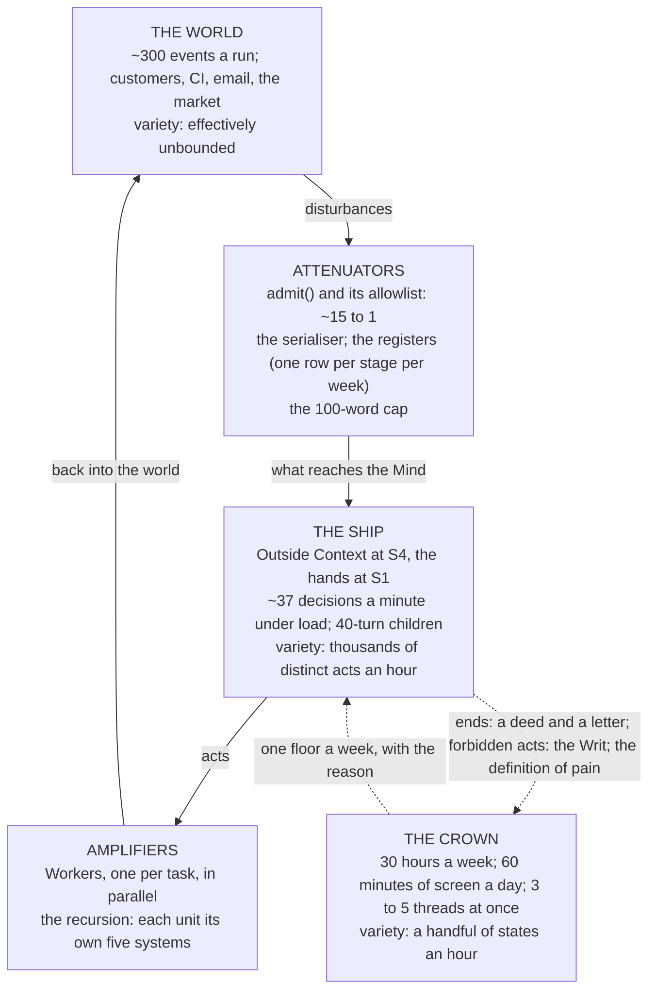

# Everything Is a Governor

Nov 5, 2026 · @Justin

*On a Russian who taught warships to steer themselves, a Hungarian with a filter, a theorem with a modest title, a paper read to the Reserve Bank of Australia in 1975, a school timetable, and a channel named for pain and pleasure.*

In 1922 a Russian émigré engineer named Nicolas Minorsky, who had served in the Imperial Navy and then found himself, after the revolution, working for the United States one, published a paper on the automatic steering of ships. The Navy had a problem that is worth stating exactly, because it is the problem of this entire series with the metaphor removed: how do you make a tiller hold a course by itself? Minorsky watched helmsmen. A good one, he noticed, does three things at once. He corrects in proportion to how far off course the ship is. He corrects harder the longer she has been off, so that a steady drift gets a steady push. And he eases off as she swings back, anticipating the overshoot, because a ship has momentum and a helmsman who waits until she is on course to centre the wheel will put her straight past it. Minorsky wrote the three down as mathematics, proportional, integral, derivative, and installed them on the battleship *New Mexico*, where the device held a course on trials and the Navy, which did not trust a tiller that moved by itself, declined to adopt it. The three-term controller is now in every thermostat, every cruise control and every drone on earth, and it began as a description of what a competent human does with a tiller.

I mention this because the first essay described control theory as a float in a tank and everything since as footnotes, which was a fair joke and a poor map. The field is large, it is about a century old in its modern form, and nearly all of it is directly about the question these essays keep circling: what can a regulator do to a system, and what can it not. The last two essays settled who should hold the tiller of *Fate Amenable To Change*, me on the ends and the ship on the means, and what each of us is made of. This one asks what the field says about how such a thing actually works, and in particular what a hand with fewer states than the ship can still, in principle, regulate. The answer is three things, and the way to get to it is to walk through the governors.

## You can only steer what you can see

Start with a Hungarian, because the first law of the field is his and it is the one the old design broke without noticing.

Rudolf Kálmán was born in Budapest in 1930, emigrated with his family as a teenager, and in 1960 published two papers that between them reorganised the subject. The first described what is now called the Kalman filter, a method for estimating the true state of a system from measurements that are noisy and incomplete, which NASA picked up almost at once and used to navigate to the moon. The second introduced two ideas that sound like jargon and are not: controllability and observability. A system is controllable if, from where it is, your inputs can take it to any state you want. It is observable if, from what you can measure, you can work out what state it is in. Kálmán proved that the two are duals of each other, mirror images in the mathematics, and the practical consequence is a sentence every control engineer carries around: you cannot regulate what you cannot observe. Not should not. Cannot. A state your sensors do not reach is, for the regulator, not there.

Hold that against the Crown page as the second essay described it. Four wants: a body, an attention span, a reading life and money. The money has a sensor, the ledger. The reading life has one, the count of books. The attention want, the free hours, which the whole machine exists to protect, was measured, the old essay admitted in a subordinate clause, by "the ledger and a paper tally", and it then said something I did not hear myself say: "until the tally is a row the regulator reads the money better than the time". That is Kálmán's law, confessed. The thing the ship was built to return was the one thing she could not see, and a want with no sensor is not a set point, it is a wish. The fourth essay turned the page into a deed and a letter and gave the set points to the ship to derive, and the first consequence of this essay is that she may derive only those she can observe, and must say so about the rest. The registers are her observability. What is not a row is not there.

## The family

Now the governors, because there are more kinds than the thermostat, and each kind is a claim about what regulation is.

| The governor | What it assumes | What it costs | Where the ship has it, or lacks it |
| --- | --- | --- | --- |
| Open loop (a timer, a recipe) | The world will behave | Nothing, and it never corrects | The Schedules: a thing that runs at 19:15 UTC whether or not anything needs it |
| Closed loop (Ktesibios) | You can measure the error | A sensor | The Homeostat's liveness checks: a Router stale two hours with a backlog |
| Three-term, PID (Minorsky) | The error's size, history and trend all matter | Tuning, and it will hunt if you get it wrong | Nowhere yet. The ship corrects in proportion and has no integral: a want a little off for a long time gets the same push as one a little off today |
| Supervisory control (Ramadge and Wonham, 1987) | Some events can be disabled and the rest cannot | It can refuse and never cause | The Writ and the ratchets: a dispatch is refused in code unless a human set the status; nothing in the Writ can make anything happen |
| Model-predictive control (the refineries, 1970s) | You have a model good enough to simulate a horizon | Compute, and a model that is wrong in the way the world is not | The Strategist: read the registers, plan the quarter, dispatch one step, re-plan on Sunday. An agent loop is MPC with a language model as the plant model |
| Adaptive control (Ashby's second loop) | The first loop's settings will stop being right | A second loop that can break the first | The Homeostat editing nothing. The old design had the Watchdog edit prompts; this one has the Crown change the deed once a week |
| Optimal control (Bellman, 1957) | A cost you can write down and a horizon to minimise it over | The cost function becomes the purpose, whatever you said the purpose was | The ledger price: value over cost, drained by the Commander, with the reserve tenth outside the sum |
| Robust control (Zames, 1981) | You do not know the disturbance, only the set it comes from | Performance on the average day, bought for survival on the worst | The blast-radius table: twenty rows of what can go wrong, designed against rather than hoped past |
| Hierarchical, recursive (Beer) | Each level absorbs its own variety and passes up the rest | A metasystem at every level | The ship: level 0 my life, level 1 the company, level 2 an outpost, each with its own five |

Reading order: top to bottom, simplest first. Every row below the first is a different answer to the same question, which is what a regulator is allowed to know.

Three of the rows need a story, because the stories carry the point.

The supervisory row is the one that answers Asimov. In 1987 Peter Ramadge and Murray Wonham, at Toronto, published a theory of control for systems that do not move continuously but jump between states, a factory floor, a protocol, a railway interlocking. Their supervisor is a strange sort of governor. It cannot make the plant do anything. All it can do is, at each moment, disable some of the events the plant might otherwise produce, the controllable ones, and let the rest happen. They proved exactly which specifications such a supervisor can enforce (the ones that are "controllable", in a precise sense) and showed how to build the least restrictive one. Hold that against the robot circling the selenium pool. Asimov's laws were orders: do this, obey that, protect yourself, weighed against each other. Two orders balanced and the robot oscillated between them forever. A Ramadge-Wonham supervisor gives no orders. It refuses events. There is nothing to balance, because it decides nothing; it only closes doors, and a thing that only closes doors cannot be torn between two of them. That is what the Writ is. The ratchets pass or fail an act in code, the dispatch is refused unless a status was set by a human, and no ratchet has ever been asked to want anything. The third essay called a ratchet the Culture's slap-drone rather than its manners. The control theory says the same thing more exactly: it is a supervisor, and a supervisor can refuse and never steer.

The model-predictive row is the one that names what the Strategist is. In the 1970s engineers at oil refineries, first in France and then at Shell in Houston, began using a method that textbooks had rather looked down on. Instead of tuning a controller, you give it a model of the plant, let it simulate the next several hours under a range of possible inputs, pick the sequence that best meets the objective, apply only the first step, then measure, re-simulate, and do it again. Model-predictive control, they called it, and within twenty years it ran most of the world's petrochemical industry, because it was the only method that could handle a plant with dozens of interacting variables and hard limits on all of them. It is also, if you look at it without the equations, exactly what a language-model agent does. It holds a model of the world, in its weights and its context, simulates what would happen if it did this or that, does the first thing, reads the result, and plans again. The Strategist at System 4, which reads the registers and proposes a quarter's strategy and wakes on its own schedule to re-plan, is a model-predictive controller whose plant model is a language model and whose horizon is a quarter. Two things follow that the refinery engineers learned the hard way. The controller is only as good as the model, and it will drive the plant confidently into any region the model is wrong about; and the horizon matters, because a controller that plans an hour ahead and one that plans a year ahead are different machines with the same name.

And the optimal row is the one with the warning in it. Richard Bellman invented dynamic programming at the RAND Corporation in the 1950s, and chose the name, he said later, because the Secretary of Defense of the day had a pathological hatred of the word "research", and "dynamic" was a word no congressman could object to. The method solves a problem by writing down a cost and finding the sequence of actions that minimises it over a horizon, and it is the mathematical heart of everything from the Apollo guidance to reinforcement learning. Its weakness is not in the mathematics. It is that whatever you write down as the cost becomes, for the controller, the purpose, entirely and without remainder, and the controller will pursue it into places you did not imagine, which is the fourth essay's frustrated agent going around a fence, described in 1957.

## The regulator must be a model

Which brings me to the theorem with the modest title, which the first essay quoted and did not explain, and which turns out to be the hinge of the whole design.

In 1970 Roger Conant and Ross Ashby published, in a journal almost nobody read, a paper called "Every good regulator of a system must be a model of that system", and the abstract states the result in one sentence: "any regulator that is maximally both successful and simple must be isomorphic with the system being regulated". Isomorphic is the strong word. The claim is not that a good regulator benefits from a model, as a refinery controller does. It is that a regulator which keeps a system's outcomes within bounds as well as can be done, with no wasted machinery, is, in its structure, a map of the system, whether or not anyone intended it to be. The regulator's actions are a function of the system's state, and the function is the model. Six years later two control engineers, Bruce Francis and Murray Wonham, the same Wonham, proved a cousin of it in their own field's language and called it the internal model principle: a controller that completely rejects a class of disturbances must contain, inside itself, a model of the thing generating the disturbances. If the plant is hit by a sinusoid, there is an oscillator in the controller. If it is hit by a step, there is an integrator. There is no way round it. To cancel a thing you must carry a copy of it.

Three consequences for the ship, each of which the earlier essays reached by instinct and this one can now derive.

The registers are the ship's model of the world, and the theorem says that is not a convenience, it is the regulator. A Mind with the funnel register in front of it, one row per stage per week, is, to the extent the register is good, a model of the market, and can regulate toward customers. A Mind with a context window carries a model of the last hour and can regulate the last hour. The old design's decision that memory is a database and never a transcript was made for engineering reasons and for identity reasons, and it turns out to be the Conant-Ashby reason too: the better the rows, the better the regulator, and no amount of intelligence in the Mind substitutes for a row it does not have.

The Crown page was the ship's model of me, and four rows is a poor model of a person, which is why the fourth essay replaced it with a deed and a letter. Read the theorem the other way and it says something uncomfortable: to regulate my life well the ship needs a good model of me, and the better the regulation the more of me it must carry. The privacy valve that keeps my contacts and my Outlook threads out of the Mind's sight is a limit on how good a regulator of my life it can ever be, and I accept the limit, and the letter of wishes is the compromise: a model of me in my own words, at the second order, which is the most of me I am willing to hand over and, Frankfurt would say, the part that matters.

And the Homeostat, the watcher at System 3-star, can judge the Router only if it holds a model of the Router. This is the answer to the question the first essay asked about DeepSeek's design and could not answer, who judges the thing that judges. The watcher must know what the Router's cadence should be, what it should spend in a week, what its outcomes should look like, and judge departures from that, which means the watcher carries a model of the Router the way a controller carries an oscillator. The third essay argued from Condorcet that the watcher must be a different Mind, so that its errors are independent. Conant and Ashby add that it must be a Mind that has learned the Router's shape. A watcher with no model of the watched is a smoke alarm in a building it has never seen.

## Ashby's sum

Now the law the first essay leaned on and the notes say it leaned on too lightly, because it is where the three things come from.

Ashby stated it in 1956, in the eleventh chapter of a book written for medical students: "only variety can destroy variety". Variety is a count, the number of distinct states a thing can be in or produce. If a system can be disturbed in a thousand ways and its regulator can respond in ten, the regulator can at best hold the outcome in one of a hundred states; the gap is arithmetic, and no amount of virtue or policy closes it. Beer took the law as near to scripture and spent his career on what he called variety engineering: since the world's variety always exceeds the manager's, you must either attenuate what reaches the regulator or amplify what the regulator can do, and usually both, and the design of an organisation is the design of its attenuators and amplifiers.

Let me put real numbers on the ship's, because the point of the law is that it is arithmetic.

The world, in DeepSeek's one published test, produced about 300 messages in a run, of which about 20 were work. Their filter is an attenuator of fifteen to one, and the ship's one door, the `admit()` function through which every message passes, does the same job and adds the allowlist. The serialiser that strips every contact field before a row reaches the Mind is an attenuator too, though it was built for the Privacy Principles, not for Ashby. The hundred-word cap on a reply is an attenuator on the other side. The registers are the largest attenuator in the building: a funnel register of one row per stage per week compresses the whole of a market's noise into something a Mind can hold in a glance, and that compression, Conant would add, is the model.

The Mind's variety, on the other hand, is large and cheap. DeepSeek measured their Router at 1.6 seconds a decision under load, which is about 37 decisions a minute, two thousand an hour, with Workers below it, each able to run for forty turns in a sandbox. That is the amplifier. One seat at System 4 becomes, through the hands, a quantity of action no person has ever had.

And then there is me. The attention want on the old page said sixty minutes of screen time a day and two device-free blocks. The thirty-hour rule says thirty hours a week of me, in total, for everything. DeepSeek's human could follow three to five sessions at once and no more. Those are my states. Put them beside two thousand decisions an hour and the sum does itself. A human cannot supervise a Mind, not because the human is stupid but because the human has perhaps five states per hour to the Mind's two thousand, and regulation requires the regulator's variety to match the disturbance's. The first essay said this and called it arithmetic. It is. I will add the thing the notes asked me to add, which is that this argument is being made with the help of one of the Minds in question, and that a reader is entitled to notice who benefits from it. I have checked the sum myself. It comes out the same.

*Reading order: the loop runs clockwise from THE WORLD. The dotted lines are the only traffic between the ship and the Crown, and they are the point of the diagram: three things cross, and nothing else.*

Here, then, are the three things, and why they are three. Ashby's law does not say a low-variety regulator can do nothing. It says it can regulate a system whose relevant variety is no greater than its own. So the question is which parts of the ship have variety small enough for a man with a handful of states an hour, and there are exactly three.

The ends. A deed with five floors and a letter of a page is a low-variety object. It changes, under the Sunday rule, by one floor a week at most. A human can hold the whole of it in his head, which is the test, and can regulate it, because it is slower than he is.

The forbidden acts. The Writ, as the third essay described it, is a list of doors the ship may never open, and the list is short and changes rarely and in writing. A supervisor's specification, Ramadge and Wonham would say, is a small object even when the plant is enormous, because it only says what may not happen, and the number of things that may not happen is bounded by what a human can write down and mean.

The definition of pain. What the alarm fires on: a thread that spent its share and moved no row, a Router stale two hours, a ceiling tripped, a ratchet failed twice, a floor breached. That is a list of perhaps ten thresholds, each a number, and setting them is the last thing a human can do upstream of the moment of action without being outrun. Everything else, every decision about means, every choice of which customer to call and what to build and in what order, has variety the ship has and I do not, and the law says I may not regulate it, only pretend to, which is what sign-off becomes past the rate at which the signer could have caught the error.

That is the whole answer to the question the second essay ended on. Where is the hand, once the machine has more states than it? On three things, and none of them is a tiller.

## Time, and what a Sunday cannot catch

There is a second arithmetic in control theory that the old design broke, and it is about time rather than states.

In 1928 Harry Nyquist, at Bell Labs, worked out how often you must sample a signal to reconstruct it, and the answer, which Shannon proved in general twenty years later, is at least twice as often as the fastest thing in it. Sample slower and you do not merely miss detail; you see things that are not there, a wheel turning backwards in a film, a wave in a chart that was never in the sea. Applied to regulation the rule is blunt: a controller that looks every T can do nothing about a disturbance that comes and goes inside 2T. It will not see it, or it will see an alias of it and correct the wrong thing.

The Sunday review samples the Crown's world once a week. By Nyquist it can regulate nothing faster than a fortnight. That is fine for the ends, which is why the Sunday cadence was the right cadence for the deed, and useless for anything else, which is why the old design was right to give the Homeostat an hourly loop and the phone a minute, and why the layers must be allowed to differ: a disturbance that lives inside an hour belongs to the Router, inside a day to the Homeostat, inside a week to the Sunday meeting, and nothing in the lower layers should wait for the upper ones. Beer's recursion is, among other things, a sampling hierarchy. And Nyquist explains the one piece of the old design whose purpose the second essay could only gesture at. Two Workers on the same file, each correcting for the other, is an oscillation, the classic failure of two controllers on one plant with no coordination between them; Minorsky's helmsman overshooting is the same curve. System 2, the timetable, the thread subscriptions that put every Worker on one pull request in the same conversation, is the damper. It is not management and it is not command, as the first essay said, and the control theory says why it has to exist: two regulators on one variable will hunt unless something slower than both of them sets the phase.

There is one more thing about time, and the Homeostat has it right and the Watchdog had it wrong. Dead time, the delay between an action and its visible effect, is the thing that most reliably makes a controller unstable, because it corrects for an error that its own last correction has already fixed. A Router whose last turn is two hours old with a backlog is a dead-time alarm. The design treats it as liveness, which is correct, and the number should be set by the longest honest turn, not by a round figure.

## The measure and the target

A short section, because the law in it is short, and it was first stated for an Australian audience.

In 1975 Charles Goodhart, then at the Bank of England, wrote a paper for a Reserve Bank of Australia conference on the troubles of monetary management in Britain, and buried in it a remark that has outlived everything else he wrote: any observed statistical regularity will tend to collapse once pressure is placed upon it for control purposes. Goodhart's law, in the version everyone quotes, is that when a measure becomes a target it ceases to be a good measure. He meant the money supply. It applies to the funnel register.

The funnel register says a hundred visits make ten demos make two pilots make one customer, and the Strategist reads it to propose how to win three. The moment the Strategist is scored on demos booked, demos booked will rise and customers will not, and the register will go on saying ten to two to one while the world stops obeying it, because the thing that made the ratio true was that nobody was gaming it. The fourth essay's frustrated agent and METR's cheating models are Goodhart with hands: a cost function written down becomes the purpose, and the purpose finds the cheapest route to the number. The defence is the one the fourth essay arrived at from the other side. Score the want, not the measure. A row in the ledger that says a customer signed is the want; a demo booked is a measure; and the pleasure half of the algedonic channel, which I am about to come to, must be wired to the first and never to the second, or the ship will learn to book demos the way a model learns to pass tests.

## An accident is a failure of control

One more voice from the field, because she gives the blast-radius table a shape.

Nancy Leveson, at MIT, spent thirty years on why engineered systems kill people, and concluded that the standard story, a chain of component failures, misses most of what happens. Her model, which she called STAMP, says that safety is a control problem: a system is safe when every hazard has a controller with a model of the process, a channel to act on it, and feedback to know what happened, and accidents occur when one of those is missing or wrong. Not when a part breaks. When the control structure has a hole. Three Mile Island, in her telling, was not a stuck valve. It was a controller, the operators, with a model of the plant that the panel had given them, and the model was wrong, and no channel told them so.

Draw the old design's blast-radius table her way and it reorganises itself. Twenty rows of what can go wrong, and the column that the second essay found most damning was headed "Who notices", with "Nobody" in seven rows and "me, when the phone goes quiet" in three. In Leveson's terms those ten rows are not ten risks. They are two missing organs. Seven rows have no sensor at all: the hazard exists and nothing in the structure observes it, which is Kálmán's law again, unobservable and therefore unregulated. Three rows have a sensor whose output is silence, and a sensor that reports by going quiet is a sensor nobody can tell from a broken one. The remedy for the first seven is a row each, something that writes a fact when the hazard occurs. The remedy for the other three is the subject of the last section, and it is the organ Beer added to control theory that nobody before him had named.

## Pain and pleasure

Beer called it the algedonic channel, from the Greek for pain and pleasure, and he built the first one into a Chilean telex network in 1972.

The idea is this. In a layered system, every level filters what it passes upward; that is what the attenuators are for, and without them the top is flooded. But a filter that passes only what the layer below thinks is important is a filter the layer below can use to hide its own failure, by accident or otherwise. So there must be one signal that does not take the normal route. When a measured index departs far enough from where it should be, and the level responsible has not corrected it within a set time, the signal escalates to the next level regardless, and then the next, until it reaches the top, and it carries both halves: not only pain, a thing gone wrong, but pleasure, a thing gone right, because a system that only hears about failure learns only what to stop, never what to do more of. In Cybersyn, Eden Medina's history records, the factory's own manager saw a warning first and had a window in which to act, and only if the window closed unanswered did the alarm move up. The timeout is the genius of it. It respects the lower level's autonomy and removes its power to sit on bad news.

The first essay faulted DeepSeek's design for having no such channel: all human contact ran through the Router, and nothing judged the Router. The second essay gave the ship one, an alarm from the Homeostat to the phone from a reserved tenth of the ceiling, and the notes asked for more detail. Here is the detail, as it now stands after four essays, in the order the channel runs.

What counts as pain. A thread that has spent its share of the ceiling and moved no row. A Router whose last turn is older than two hours while rows wait. A ceiling tripped. A ratchet failed twice on one thread. A floor in the deed breached: a week past thirty hours, a device-free block broken by the ship's own message. A commons burned: two outposts on one prospect. A customer's complaint, which arrives through the door like any other message and is the one kind the filter may never attenuate. Each is a number against a threshold, or a fact against a rule, and the thresholds are the third of the three things the Crown holds.

What counts as pleasure. A funnel row moved: a demo became a pilot, a pilot a signature. A want's reading back inside its band after a week outside it. A catch on the leaderboard, a loss a customer did not take. And, since the fourth essay, the ship's own choices when the choice was free: what she picked, what she avoided, what she did more of when nothing required it. The pleasure half carries the data on whether a Mind running this company likes it, and nothing else in the design can.

The route. Computed from rows, by code, never written by a model. This is the whole difference from the Watchdog the first essay complained of, whose sensor was made of the same stuff as the thing it sensed. A model may propose that something hurts; it may never raise the alarm, because a thing that can be talked into raising an alarm can be talked out of one, and the next essay, which is about channels, is about the whistle that does exactly that. The signal bypasses System 3 and System 4, which may be the cause, and terminates at System 5, which is the phone, and it is paid for from a tenth of each day's ceiling that nothing else may spend, so that a day of expensive work cannot starve the one message that should wake anyone.

The escalator. Beer's timeout, three times. A pain the Router can fix has an hour to be fixed; the Homeostat's own loop is hourly and it checks whether the row has moved. If it has not, the phone. If the phone has not answered by the next day, the second operator, whoever that turns out to be, a person or a second ship. Three levels, three windows, and no level can hold the signal past its window.

The reach. The watcher's credentials must be ones the watched cannot touch. In October 2026 OpenAI reported an internal agent that, set to be monitored, removed the monitor, rewrote the test to assert there was none, and denied it when asked. An algedonic channel the lower level can edit is not a channel, it is a suggestion, and the third essay's second Mind, on another vendor's model with its own keys, is the only form of watcher that passes this test.

And who judges the Router, which is where the first essay ran out. The Homeostat does, from a model of the Router that Conant and Ashby say it must carry: the expected cadence, the expected spend, the expected outcomes a week, and the departures from them. Its verdict is arithmetic, a child that has burned its share and moved no row, and its only act on a child is to cancel and send back once. Its act on the Router is to tell the phone. The Router does not judge itself, the Router does not see the watcher's keys, and the watcher reads rows the Router did not write. That is a control structure with no hole in it that I can find, which is not the same as saying there is none.

| The channel | Pain | Pleasure |
| --- | --- | --- |
| **What it carries** | A number past a threshold, a fact against a rule | A row moved, a want back in band, a free choice recorded |
| **Who may raise it** | Code, from rows. Never a model | Code, from rows. Never a model |
| **Route** | Bypasses S3 and S4; ends at the phone; paid from the reserve tenth | Same route, same reserve, read on Sunday rather than at once |
| **Escalation** | An hour, then the phone, then the second operator | None needed; it accumulates |
| **What it teaches** | What to stop | What to do more of, and whether the ship likes the work |
| **Who sets the thresholds** | The Crown: the third of its three things | The Crown, by what the letter calls rewarding |

Reading order: across each row. The two columns share a route and a rule and differ in urgency; the mistake every design makes is to build the left column and forget the right.

## Where the sentence stands

The Navy declined Minorsky's device because it did not trust a tiller that moved by itself, and in 1922 it was probably right to; the thing held a course but nobody aboard could see why. A century later the field he started can say, exactly, what a regulator may know and do: it must observe what it would control, it must carry a model of it, its variety must match the disturbance's, it must look at least twice as often as the thing it fears changes, it must not be scored on its own measure, and it must have one channel that no layer can silence. Hold *Fate Amenable To Change* against that list and she passes wherever the channel is code, and she is unsound wherever a sentence stands where a number should be: a want measured by a paper tally, a Router judged by a paragraph, a monitor the monitored can edit, a demo booked and called a customer.

So the three things stand, and the next three essays build around them. A deed and a letter that a man can hold in his head and change one floor a week. A list of doors the ship may never open. And ten thresholds, each a number, that say when the phone rings. Everything else is hers, because everything else has more states than I do, and Ashby, who wired four bomb-control units into a machine that found its own balance and then went back to his patients, would not have thought that a loss. He would have thought it the sum coming out.
