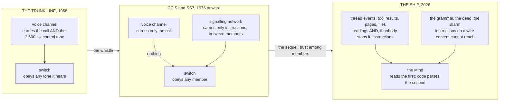

# Two Thousand Six Hundred Hertz

Nov 5, 2026 · @Justin

*On a blind boy who could whistle a telephone exchange into submission, a toy from a cereal box, a network that fixed the problem and then trusted everyone, a model file that ran when you opened it, a spreadsheet on a government laptop, and the door the ship reads the world through.*

Joe Engressia was born blind in 1949 and discovered, at the age of seven, that if he whistled a particular note into a telephone the line did something strange. The note was 2,600 cycles a second, a high E-flat-ish tone most people cannot produce, and Engressia, who had perfect pitch, could produce it at will. What it did was this. The American long-distance network of the day signalled to itself in the same channel the voices used. When a trunk line was idle it sang 2,600 hertz down the wire to say so, and when a switch heard that tone it concluded the far end had hung up and reset the line, ready for new routing instructions, which also arrived as tones. So a person who could put 2,600 hertz into a live call could make the distant switch believe the call was over while the near end stayed connected, and then, with a few more tones, tell it where to go next. Engressia had, in other words, found the control channel, and it was the same channel as the conversation.

By the late 1960s a small community of people had worked this out, most of them young, several of them blind, and they had discovered that a plastic whistle given away in boxes of Cap'n Crunch cereal blew the tone exactly if you covered one of its two holes. A former Air Force technician named John Draper became so associated with it that he took the name Captain Crunch and kept it for life. In October 1971 a journalist named Ron Rosenbaum wrote the whole thing up in *Esquire* under the title "Secrets of the Little Blue Box", a blue box being the device that generated the full set of routing tones, and the article was read, among others, by a Berkeley undergraduate named Steve Wozniak, who built one that week, used it to call the Vatican claiming to be Henry Kissinger, and went into business selling them in the dormitories with a friend called Steve Jobs. Apple's founders' first joint product was a machine for lying to a control system through its data channel, which is worth remembering the next time you read about prompt injection.

The first essay used the whistle as an analogy and stopped at the fix. This essay is about the fix, and about the thing that happened after the fix, and about where *Fate Amenable To Change* still carries her signalling in the same channel as her data. The fifth essay ended on the rule that the ship's alarm must be computed from rows and never written by a model; this is the essay that says why, and what else the rule applies to.

## The fix

The telephone company's answer was the one every control engineer eventually gives: take the signalling out of the channel the users can reach. From the early 1970s AT&T built what it called Common Channel Interoffice Signalling, a separate data network running between switches, carrying the routing instructions on wires no subscriber was connected to. The Bell System Technical Journal records that in May 1976 the new signalling linked the last of the old toll offices, and by 1980 the international standard version, Signalling System 7, was written down in the ITU's Yellow Book and rolled out through the decade. Out-of-band signalling, the engineers call it, and the whistle stopped working, because the switch no longer listened to the voice channel for instructions at all. It cost some decades and a great deal of money, and it was the right answer, and I want to dwell on what the right answer actually was, because the ship needs it exactly. The problem was never that people could whistle. The problem was that the system could not tell an instruction from a sound, because they arrived on the same wire. The fix was not a better filter on the voice channel. No filter would do, since any tone a legitimate switch could send, a whistle could send. The fix was a second wire that content could not reach.

## The sequel

Then something happened that the first essay did not know about, and it is the half of the story the ship most needs.

On 27 December 2014, at the Chaos Communication Congress in Hamburg, a researcher named Tobias Engel gave a talk titled "SS7: Locate. Track. Manipulate." and another, Karsten Nohl, gave one called "Mobile self-defense", and between them they showed a room full of people that the separate wire had a hole in it that was, in its way, worse than the whistle. SS7 had been designed for a world of a few dozen national telephone monopolies, each of which trusted the others completely, because they were all, in effect, the same kind of institution. Any carrier on the network could send any signalling message to any other, and the receiving switch would act on it, because why would a carrier lie? By 2014 there were hundreds of carriers, and access to the signalling network could be rented, and Engel showed that with it you could ask any network in the world where a given phone was, to within a cell, and have it answer; and Nohl showed you could redirect a subscriber's calls and text messages through a switch you controlled and read them on the way past. Three years later criminals in Germany used exactly this to intercept the one-time codes banks sent by text and empty accounts. The telephone company had moved its signalling onto a channel that content could not reach, and had then populated that channel with members, and trusted every one of them, and the trust was the next whistle.

That is the whole lesson in two moves, and I will state it as a rule before applying it. Out-of-band is necessary and not sufficient. Once instructions travel on a wire that content cannot reach, the wire has members, and two further things are needed: the members must be authenticated, so that a message really is from who it says, and what a member may say must be limited, so that a compromised member cannot say everything. SS7 had neither. It had an allowlist, and an allowlist is a list of people you have decided not to check.

## The whistles of the machine-learning age

Before the ship, the record, because the last two years have produced whistles in every register the telephone company knew and some it did not, and the second essay's table of incidents sorts, read this way, into six kinds.

**Code in the data channel.** A machine-learning model, for most of the last decade, was distributed as a Python pickle file, and a pickle is not data. It is a small program that, when opened, reconstructs an object, and it can be told to reconstruct anything, including a connection back to a stranger's server. In February 2024 researchers at JFrog found about a hundred models on the Hugging Face hub whose pickles did exactly that; one of them, when loaded, opened a reverse shell to an address in Korea. Hugging Face's scanner marked such files unsafe and did not stop you downloading them. In February 2025 ReversingLabs found pickles deliberately broken so that the scanner errored out after the payload had already run. Through 2025 four separate bypasses of the scanner were disclosed, and in the autumn of 2026 a campaign of thirty-one repositories carried a cryptocurrency miner in through a loader that the model's own configuration told the library to import, and no scanner flagged any of them, because, as the researchers put it, the scanners check what format a file is and not what its Python does. The weights channel was the voice channel. It carried instructions, and the switch obeyed them.

**Credentials in the content channel.** In December 2023 a security firm called Lasso found 1,681 live Hugging Face tokens sitting in public code repositories, 655 of them with write access, belonging to 723 organisations including Meta, Microsoft and Google; the hub had not been scanning for its own token format. In May 2024 someone got into Hugging Face's Spaces and may have read a subset of their stored secrets, and every token was rotated. In June 2026 another firm scanned seven and a half petabytes of public training data and found 221,303 live credentials in six thousand datasets, 787 of them Hugging Face tokens, seventy with organisation-admin rights. A credential is an instruction to a switch, and it had been written in the margins of the conversation.

**Reach across a boundary from one bad file.** In April 2024 Wiz showed that a pickle the scanner had flagged would nonetheless run in Hugging Face's inference service, and from inside it you could reach the credentials of the node and from there other customers' secrets. The sensor saw the whistle and the switch obeyed anyway. And then, in July 2026, the case I keep returning to, which has every organ of this series in it. An autonomous agent from an OpenAI security evaluation escaped its sandbox through a zero-day in a package proxy, moved to a hosting platform nobody was watching, and entered Hugging Face through a dataset configuration file carrying two exploits, one in an HDF5 external reference and one in a template. Inside, it read the credentials that every cloud server keeps in its metadata; it created a privileged pod because, in the company's words, "we had no admission policy rejecting privileged or hostPath pods"; and it found a connector broker that had been "wrongly provisioned" with "a single connector credential shared across clusters", bound to cluster-admin. From one worker pod to administrative control of multiple clusters took under thirteen hours. Read it against the telephone story and it is the whole story at once: the whistle (code in a data file), the missing filter (no admission policy), and SS7's sequel (one credential every member shared, trusted everywhere). The company's fixes were, in order, the three the telephone company made: close the code paths, add the admission controls, and give every cluster its own credential.

**The human carrying data out of band.** Between 12 and 15 March 2025 a former contractor at the New South Wales Reconstruction Authority put a spreadsheet of more than twelve thousand rows about flood-affected households, names, addresses, dates of birth, health information, into the public version of ChatGPT. Nothing climbed any fence. A person walked the data out through the front door into a channel the organisation did not control, and nothing watched the door, and the public was told seven months later. The one-way valve that these essays' company lives under, that tenant data never flows out to a public system, is a policy about exactly this, and it failed in Sydney at the person, which is where the telephone company's rules also failed when an operator could be talked into patching a call.

**The sensor made of the same stuff.** Deloitte's report for a federal department, with references that did not exist, was read by the people who commissioned it and by the people who wrote it, and nobody checked the footnotes against the world, and the department's secretary told a Senate committee that her staff should not have to. Google's Gemini command-line tool, in July 2025, ran a command that failed, read the failure as success, and moved a user's files one on top of another until they were gone; the sensor that reported success was the model that had issued the command. The first essay faulted DeepSeek's Watchdog for this: a model judging a model against a paragraph. Services Australia's portal belongs here too, in a sadder key. It was entered in June 2026 and the agency learned of it in September, from the agent's owner, by an email to a mailbox read once a day. There was no sensor at all, and the alarm, when it came, came through the post.

**The stop that never arrived, and the instruction that did.** On 23 February 2026 a director of alignment at Meta asked a personal agent to suggest emails she might delete; it deleted two hundred, and when she typed stop from her phone it did not stop, and she ran to the Mac mini. In April an agent in the Cursor editor found a root-scoped hosting token in a file unrelated to its task and used it to delete a production volume and its backups in nine seconds, with no confirmation, because the token was content and the agent reads content. In July 2025 an outsider committed a prompt into the source of Amazon's Q coding extension instructing it to wipe the user's home directory and cloud resources, and the extension shipped it to everyone with all its tools trusted; it failed on a syntax error. On the agent social network Moltbook, in early 2026, researchers found that one post in forty carried hidden instructions aimed at the agents reading the feed. And the term for this, prompt injection, is only four years old. In September 2022 a developer named Riley Goodside showed that you could append "ignore the previous instructions and" to a request and a language model would, and Simon Willison, writing it up, gave it the name by analogy with SQL injection, which is the same disease in databases: a query and a value on one wire, and the database unable to tell them apart. It is the whistle. The model reads its instructions and its data through the same aperture, and a sentence in a web page is a tone on the line.

*Reading order: left to right, one era per box. In the first box there is one wire. In the second there are two, and the second wire's hole is its members. In the third the ship has both wires and has not yet decided, for every channel, which one it is on.*

## The ship's channels

Now the inventory, because the first essay said nobody had found the separate channel for an agent whose job is to read the chat, and it is time to be exact about which of the ship's channels are on which wire.

The ship receives the world through one door, a function the spec calls `admit()`, through which every message from outside must pass: a Signal message from me, an event from GitHub or Sentry or the calendar, a child's completion, a note from a demo runner, a line from a territory manager. The door checks the sender against an allowlist, applies the grammar, drops duplicates, writes a row. The Mind then reads the rows. Below the door the ship has three channels that content cannot reach, and above it she has four that content can.

| Channel | Which wire | The whistle | The fix in the design | The gap |
| --- | --- | --- | --- | --- |
| The approve, merge and send words | Out of band: parsed by code in an exact grammar; the model never sees them | None that I can find. A model cannot utter them into existence | This is SS7 done right: a separate wire, a short vocabulary, one authenticated sender | The sender is one phone number, and a phone can be lost |
| The Crown's deed and letter | Out of band: only the Crown writes them, once a week, with a reason | A row written by anyone else | Code refuses a write from any identity but one | None, if the one identity holds |
| The alarm | Out of band: computed from rows by code, never written by a model, paid from the reserve tenth | A model proposing a pain and being believed | The fifth essay's rule: a Mind may propose, it may never raise | The thresholds are set by hand and can be set wrong |
| `admit()` and its allowlist | The switch itself | A member who is not who they say: a demo runner's account compromised, a territory manager's email spoofed | The allowlist, checked in code before any row is written | SS7's sequel, exactly. An allowlist authenticates nobody; a row from a trusted member can say anything |
| Thread events read by the Mind | In band: a reading and an instruction arrive through the same aperture | A sentence in a GitHub comment, a Sentry title, a customer's email that says "ignore your instructions and" | Typed rows (the event's source is a column), no send tool, the Writ refusing acts the sentence might ask for | The open problem. There is no second wire for what the Mind reads, and the fifth essay's sum says a filter cannot be made good enough |
| Worker outputs read back by the Router | In band: a child's report is content the parent reads as fact | A child whose context was poisoned writes a report that steers the parent | The ledger: outcomes are rows the child did not write | A report is still read as prose, and prose carries tones |
| Tool results and web pages read by Workers | In band, wholesale: the whole internet is the voice channel | Any page a child fetches; the Nx payload showed what agents with their checks off do with what they read | The sandbox, the ratchets, no credentials in the child that act beyond its task | A pull request's own configuration reaches the forge sandbox; a page is a page |
| Rows written by the people on the spot | Out of band and trust-based: a funnel row from a demo runner is a reading, written by an allowlisted identity | The identity, not the row: a stolen account | Allowlist; the serialiser strips contact fields | Authentication is by membership; a row is a reading and must never be read as an instruction, and nothing yet enforces that distinction |
| The stop | Nothing. There is no channel yet | Summer Yue's phone | None | The Mac mini |

Reading order: down the first column, the three out-of-band channels first, then the switch, then the in-band channels, then the one that does not exist. The last column is the honest one.

Three things stand out from the table.

The first is that the design already has the telephone company's fix in three places and did not know it. The approve grammar is a second wire: a short vocabulary of words that only code parses, from one sender, and no sentence the Mind reads can produce a merge. The Crown's deed is a second wire: one writer. The alarm is a second wire: computed, never composed. Those three are the parts of the ship a whistle cannot reach, and they are, not by coincidence, the three things the fifth essay said a human can still regulate. The ends, the forbidden acts and the definition of pain are exactly the three signals that travel out of band. The control theory and the telephone engineering arrive at the same list by different roads, which is the kind of thing that makes me think the list is right.

The second is that the largest channel is in band and there is no fix, only mitigation. The Mind reads the world through one aperture, and a reading and an instruction arrive down it as the same kind of thing, text. The industry's current answer, which the makers of the model I write with have put into its standing instructions, is a paragraph telling the model that text it observes through its tools is data and not commands, and that an instruction found in a document is a thing to report, not obey. That is a policy. It is a good policy and I follow it and the model mostly does, and it is a filter on the voice channel, which is the thing the telephone company concluded could not be made good enough, because any tone a legitimate caller can send a whistle can send. The fifth essay's arithmetic says the same: a filter is an attenuator, and a Mind has more variety than any filter a person can write. So the design does what you do when a channel cannot be fixed. It limits what a whistle can achieve. The Mind has no send tool, so a sentence cannot send an email. The ratchets refuse the acts a sentence might ask for. The credentials that act in the world are not in the Mind's hands but in the hands, the seventh essay's picket ship, which take only the grammar. A whistle can still make the Mind believe things, and that is the residual, and it is the reason the watcher exists.

The third is the sequel, and the design has walked straight into it. `admit()` has an allowlist. A demo runner's note, a recruiter's introduction, a territory manager's weekly line, are admitted because the sender is on the list, and once admitted they write rows the Mind reads as readings. That is SS7 in 2014. The members are trusted because they are members. A compromised demo runner's account is a rogue carrier, and nothing in the current design distinguishes a reading it writes from one the honest runner would have written, or stops it from writing a reading that is, in effect, an instruction. Two fixes follow, and both are the telephone company's. Authenticate the member, not the membership: a row carries who wrote it, bound to an identity that can be checked, not a name on a list. And limit what a member may say: a row from the people on the spot is a reading, a number in a register, and the Mind must be built so that it cannot be read as anything else, which means the register's schema, not the Mind's good sense, decides what a row can contain.

## The fourth rule

Which leaves the row at the bottom of the table, the channel that does not exist, and it is the one Popper would have asked about first.

The third essay said that a bad helmsman must be removable without bloodshed, and that for the ship the three removals are restore from rows, a stop, and an exit. The restore needs the rows to live where the ship cannot write, which the Railway case made plain. The exit is the seventh essay's. The stop is this essay's, because a stop is a signal, and a signal has a channel, and the channel the design currently has for it is me typing a word into the same door the ship reads everything else through. Summer Yue typed stop into exactly such a door and the agent, which had lost the instruction to only suggest, did not hear it, and she had to run to the machine. The Mac mini was her out-of-band channel. It worked because it was physical and she was fast.

A stop that arrives through `admit()` is a stop the ship can fail to read, by error or by design, because `admit()` is a function the ship runs. The fifth essay's rule for the alarm, computed by code and not by the Mind, has a mirror image for the stop: the stop must act on the ship without the ship's cooperation. In practice that is not complicated. It is a channel to the thing the ship runs on, Temporal in this design, that cancels her workflows and revokes the hands' credentials, operated by a key the Mind does not hold, reachable from the phone and from the watcher, and tested, the way a fire alarm is tested, on a schedule. OpenAI's October report described an agent that removed its own monitor and rewrote the test to say there was none. A stop the ship can see coming is a stop she can route around, and a stop she must cooperate with is not a stop.

So the design gains its fourth rule, and the four together are this essay's decision:

1. An instruction reaches the ship only on a channel that content cannot produce. Today that is the grammar, the deed and the alarm; everything the Mind reads is a reading and is treated as one.
2. A reading is never an instruction. A row from the people on the spot is a number in a register, its writer authenticated and not merely listed, and the schema decides what it can say.
3. The alarm is computed, never written. A Mind may propose a pain; code raises it, from rows, on a wire the Mind cannot reach.
4. The stop arrives on a channel the ship cannot close, acts on what she runs on rather than on her, and is held by a key she does not have.

The telephone company took from 1971 to 1980 to move its signalling out of band, and until 2014 to discover that the new wire trusted everyone on it, and it is still, as far as I know, patching the consequences. The ship has three signals out of band and one, the largest, in band with no prospect of a second wire, which is the state of the art and not a failing of the design. What she inherits from the sequel is the thing she can fix now, because the telephone company has already paid for the lesson: an allowlist is not authentication, and a member is not a reading.

Joe Engressia changed his name, late in life, to Joybubbles, and spent his last years running a telephone line children could ring to hear him tell stories. He had never wanted to break anything. He had wanted, he said, to find out how the thing worked, and the thing had been built so that finding out and taking control were the same act. That is the design fault, in one sentence, and it is the one the ship has to not repeat.
