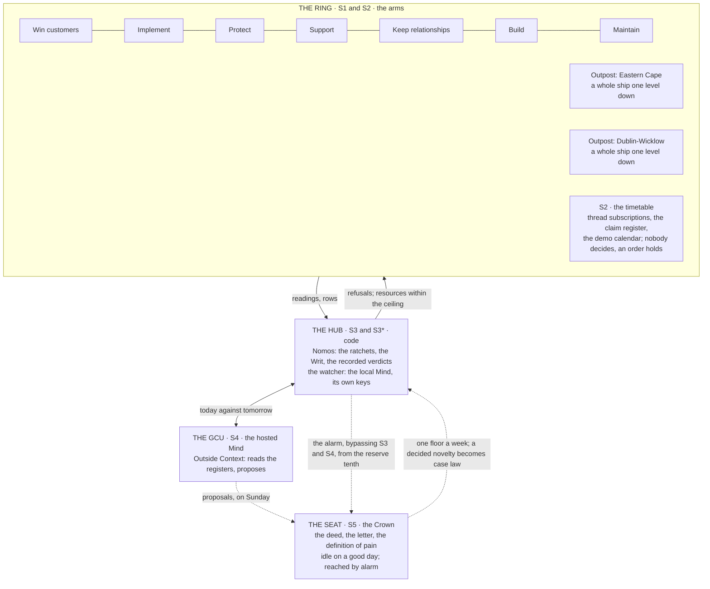

# The Octopus and the Org Chart

Nov 5, 2026 · @Justin

*On a neurophysiologist's word for a ring of values, a council in St Petersburg that lasted fifty days, a chain nobody owned until the day it did, an Arab revolt described as a gas, an animal with most of its brain in its arms, and whether one ship is enough.*

In 1945 a neurophysiologist named Warren McCulloch, who two years earlier had co-written the paper that invented the artificial neuron, published a short piece in the *Bulletin of Mathematical Biophysics* with a title only he could have chosen: "A Heterarchy of Values Determined by the Topology of Nervous Nets". It made a claim that sounds modest and is not. A nervous system, he showed, can hold preferences that do not line up. It can prefer A to B, B to C, and C to A, and this is not a defect in the wiring but a consequence of its shape, a ring where there might have been a ladder. He needed a word for an order with no top, and since hierarchy means sacred rule, he coined heterarchy, other rule, and it has been quietly embarrassing organisation charts ever since. McCulloch was a bearded, sonnet-writing polymath who became, in his last decade, a friend of Stafford Beer's and something close to a hero to him, and I think the heterarchy paper is where Beer's lifelong irritation with pyramids began.

I mention this because the first essay in this series laughed at DeepSeek for rediscovering the org chart, the cheap model on top and the clever ones underneath doing the work, and the second essay flipped the joke and found the strong model on top and the cheap ones underneath, and a reader pointed out, correctly, that both versions assumed there was a top. Beer spent thirty years telling executives that the Viable System Model is not a pyramid. The five systems are a recursion, not a ladder; System 5 is not the boss; the metasystem exists to serve the operations, not to command them. And yet every diagram of it, including the ones I have drawn, puts S5 at the top and S1 at the bottom, because that is where the paper runs out. So this essay is about shapes. What shape does *Fate Amenable To Change* have, if not a ladder. Is one ship enough. And where, in that shape, do the two things the earlier essays kept deferring, the Commons and the Outposts, actually sit.

## Every ring grows a centre

The alternatives to a pyramid have been tried, repeatedly, by people with guns and people with money, and the record is instructive in a way its enthusiasts do not like.

In October 1905 the workers of St Petersburg, in the middle of a general strike, elected a council, a *soviet*, of delegates from the factories, each recallable at any time by the people who had sent them. It was as flat a thing as politics has produced: no party, no permanent officials, a chairman who could be replaced by a show of hands. It lasted about fifty days before the government arrested it. In 1917 the soviets came back, hundreds of them, and the slogan of the revolution was all power to them, and within months of the revolution succeeding they had been captured by the one party that had kept a permanent organisation, and the recallable delegate was a memory. Robert Michels, four years before any of that, had already explained why, in the sentence the third essay quoted: who says organisation, says oligarchy. Any body large enough to need people who work for it full-time grows a class of such people, and their interest is the body's survival, and they do not go away when you vote.

The same curve runs through every attempt since. The Paris Commune of 1871 lasted seventy-two days. The Mondragón cooperatives in the Basque country, founded by a priest in 1956 and still the largest worker-owned enterprise on earth, have a general assembly, elected boards, and, by the admission of their own historians, a professional management that the assembly mostly ratifies. In 2008 someone calling himself Satoshi Nakamoto published a method for a ledger with no owner, in which thousands of strangers agree on the order of transactions by expending electricity, and it works, and it is the purest heterarchy ever built, and when its most ambitious offspring, the DAO, was drained in 2016, the second essay told what happened: a centre appeared the day one was needed, a handful of people proposed a fork, and the leaderless community voted to follow them. Even the computer scientists who design consensus protocols for machines that must agree without a boss found, in a 2014 paper called Raft that is now in most of the world's databases, that the easiest way to agree without a leader is to elect one, quickly, and replace him when he dies.

And then the military, which has thought about flat structures longer than anyone, because the alternative is being shot. T. E. Lawrence, lying ill in a tent in 1917 and thinking about how a few thousand Arab irregulars might beat a Turkish army, wrote the sentence that every guerrilla since has had pinned up: suppose we were "an influence, an idea, a thing intangible, invulnerable, without front or back, drifting about like a gas". Mao made the gas into a doctrine; the Prussians, a century earlier, had made it into a staff system called *Auftragstaktik*, mission command, in which the commander gives his officers the intent and not the orders, and expects them to work out the rest on the ground, because the ground changes faster than a courier rides. Nelson did it at Trafalgar without the German word: his captains were told what he meant to achieve and that no captain could do very wrong if he placed his ship alongside that of the enemy. And General Stanley McChrystal, finding in Iraq in 2004 that a hierarchy with a thousand analysts could not keep up with a network of men with phones, rebuilt his command as what he called a team of teams, and wrote a book about it, and the book's honest conclusion is that the network still had him in it. The intent came from somewhere. Every one of these structures, the soviet, the commune, the cooperative, the chain, the guerrilla, the staff, dissolved the pyramid and kept a centre, and the good ones differ from the bad ones only in what the centre was for.

That is the finding, and it is Beer's. You cannot prevent the centre; Michels is a law. What you can do is decide in advance what it does, and the answer the Viable System Model gives is that it does almost nothing. System 5 does not run the operations and does not command them. It says what the thing is for, it settles the argument between the part that runs today and the part that looks at tomorrow when that argument escalates, and it is where the pain signal ends. On a good day it is idle. Banks, describing the Culture, put a rule on who may sit in such a seat that the third essay quoted and that I now think is the design's: access to power in inverse proportion to the desire for it. A centre reached by alarm, occupied by someone who would rather be reading.

## The animal that does it

There is one structure that has run for three hundred million years without growing an oligarchy, and it earns a paragraph because the ship is built on it.

An octopus has about half a billion neurons, which is in the range of a dog, and about two thirds of them are not in its head. They are in its arms. Each arm has its own nervous system, dense enough to taste what it touches, to decide how to grip, and to solve a local problem, such as getting a crab out of a jar, without consulting the brain at all. Peter Godfrey-Smith, the philosopher and diver who wrote the best book about this, describes watching an arm explore a crevice while the animal's eyes were elsewhere, and the sense that the arm was, in some limited way, making up its own mind. The brain sets intent: go there, hunt, hide. The arms work out how. Nothing reports upward unless it must, because there is no bandwidth for it to; the arm's variety, in Ashby's terms, is absorbed in the arm. It is Beer's recursion with suckers, and it is the only solved case I know of a many-centred creature with a single purpose and no middle management.

The ship, then, has the octopus's shape, and I can draw it now, which the earlier essays could not.

*Reading order: the ring first, which is where the work is and where most variety is absorbed; then the Hub, which refuses and audits and never steers; then the GCU, the one Mind that looks out; then the seat. The dotted lines are the only traffic to and from the centre, and on a good day none of them carries anything.*

There is no top in that picture. There is an outside, where the work is done, and a centre, which is reached by three dotted lines and otherwise left alone. The joke about the org chart dissolves because both versions of it were drawing the wrong shape: the question was never whether the expensive Mind sits above or below the cheap ones, but whether anything sits above anything, and in a ring the answer is that the arms absorb what they can and only the rest travels inward, and inward is not up.

## One ship or a fleet

Which raises the question the third essay deferred: is one ship enough, or does the design need a fleet, and if so of what classes.

Four arguments say a fleet, and they come from four different directions. Beer's recursion already makes one: every S1 unit is a whole viable system one level down, with its own five, so an outpost is a ship, and so, in time, is each customer's implementation. Ashby's law makes a second: a Mind can be regulated only by something with variety to match, which is another Mind, and the fifth essay's sum said a human cannot be that thing. Condorcet makes a third: the second Mind improves on the first only if its errors are independent, which means not the same model with the same key reading the same newspaper. And Charles Perrow's normal accidents make a fourth, the dullest and the most important: one vendor, one key and one model is a common-mode failure, and the second essay's own confession was that when Fireworks rate-limits, the Router, every Worker and the Homeostat stall together because they share one key.

Banks built a fleet, and his classes map so cleanly onto Beer's functions that I have stopped thinking it is a coincidence. A General Systems Vehicle is, in the notes, a holographic fragment of the whole Culture, able to do anything the civilisation can. A General Contact Unit is the fast ship that goes out and looks, with a few hundred people aboard and a brief of diplomacy by subversion. A Rapid Offensive Unit is engines, weapons and a Mind, with almost nobody aboard. A Very Fast Picket is what the Culture calls a warship it has disarmed, a euphemism that everyone understands. An Orbital Hub runs a place: its transport, its factories, its maintenance, its library, its traffic. And the drones and the simpler devices do the work that nobody should have to mind. Here is the ship's fleet in those terms, with the decisions that were open until this week closed.

| Class | Banks | The ship | What it holds | What it may touch | Mind or code |
| --- | --- | --- | --- | --- | --- |
| The whole | GSV | *Fate Amenable To Change*, level 1 | Everything below | Nothing directly | Both |
| The one that looks out | GCU | Outside Context, at S4 | The registers; the deed and the letter; the horizon | Proposals, to the seat; dispatches, within the ceiling | The hosted frontier model |
| The one that runs the place | Orbital Hub | Nomos, at S3 and S2 | The Writ, the ratchets, the timetable, the claim register, the recorded verdicts | Refusals and allocations; never a steer | Code, by Banks's rule that nothing that could mind has to mind |
| The watcher | A second Mind | The Homeostat, at S3* | A model of the GCU: its cadence, its spend, its outcomes a week; the alarm thresholds | The alarm; cancel and send back, once | The local Qwen3.8-27B, on its own machine with its own keys |
| The hands that act | Very Fast Picket | The actuator, from version one | The only credentials that send, merge or spend | The world, on the grammar and nothing else | Code, thin, with the weapons off until the Crown's word |
| The drudgery | Drones | The platform | Documents from templates, counts, installs, the send path | Deterministic work only | Code |
| The ships one level down | Each its own GSV | An outpost; later, an implementation | Its own five | Its territory | Both, under the centre's rules |

Reading order: down the first column. The two Minds are rows two and four, and they are different models from different makers on different machines, which is the whole of Condorcet's condition and most of Perrow's.

Two of those rows were decisions, and I will say how they fell. The watcher runs on the local model, the twenty-seven-billion-parameter Qwen on the desk, for three reasons that each would have been enough: it is independent of the hosted Mind in make, in weights and in key; it is on a machine nobody else can reach, which the sixth essay's rule about the stop requires; and it is the same model the companion essay on the curiosity valve proposes to train, so that the ship's watcher and the ship's first home-grown Mind are one project. And the actuator exists from day one, as a thin piece of code that holds the keys and takes only the grammar, because the design already denies the Mind a send tool and this is only naming the thing that denies it, and because the sixth essay's fourth rule needs somewhere to revoke keys from that is not the Mind.

One more thing about the ship's name, since the fleet made me look it up. In *Excession*, *Fate Amenable To Change* is not a General Systems Vehicle. She is a General Contact Unit, Escarpment class, the first Culture ship to reach the thing that falls into the galaxy, ordered not to engage, who watched two other ships be taken and survived to tell it. The Atlas datasheet that calls her a GSV has the class wrong, or the name belongs to the Mind that looks out and not to the hull. I prefer the second reading. The hull is a fleet. The name is the one who looks.

## Where the Commons sits

The second essay found Elinor Ostrom's eight principles for a commons already in the design by instinct, and the Atlas page for the Commons was put under System 5, and the notes asked whether that was right. It is right for a third of it.

A commons, in Ostrom's sense, is a shared thing that use depletes, and the ship has four: the pool of prospects in a territory, which two outposts can burn by both pitching the same contractor; the firm's reputation, which one bad demo degrades for the next runner; the Crown's attention, which every outpost and every Worker can book; and the registers release and the case law, which everyone uses and someone must maintain. Ostrom's principles for running such a thing without selling it or nationalising it were clear boundaries, rules fitted to the place, a say in changing them, monitoring by the users, graduated sanctions, cheap dispute resolution, the right to organise, and nesting. Sort those by Beer's functions and they fall into three systems, not one.

The policy is S5's. That the commons exist, which four they are, and where they stand in a clash, which this week was decided: physical safety and the boys, then health, then the hours, then the commons, then money, with fairness a constraint on how any of it is pursued rather than a floor of its own. "While respecting the commons" is the second clause of the Crown's deed, and it is the only part of the Commons that belongs in the seat.

The rules are S3's. The claim on a prospect: held by whoever writes the first contact row, visible to every outpost, running fourteen days, renewed only by a logged activity and otherwise lapsing, recorded by the Vogons like any verdict. The quota on the Crown's attention: four hosted demos a week, ten messages a day in a digest, the alarm the one exception. The graduated sanctions for an outpost that burns the pool. Those are nomos, general and written and refused in code, and they live with the ratchets.

The timetable is S2's. Whose turn it is this week, which outpost has which prospect today, when the demos fall. Nobody decides; an order holds, which is Beer's test for S2, and the claim register is the water court's Thursday sitting as two columns.

And the monitoring is S3*'s, the watcher's, reading the rows rather than the claims. Ostrom's principle four, monitoring by the users, is the one the Culture does by gossip and the ship does by a Mind on a laptop.

So the page under S5 is right, and it should say that it holds the policy and point at where the rest lives. The mistake to avoid is the one the Atlas page's own subtitle half-makes, "what is shared, and can be used up": a commons is not a thing the centre owns. It is a thing the ring shares, with rules the ring can be refused by, and a seat that is consulted only when the rules have no answer.

## Where the Outposts sit, and what S2 is not

The notes asked whether the Outposts are System 2, coordination, and the Atlas ship page says so: it lists them as "S2, a ship one level down in each territory". That sentence contradicts itself, and the contradiction is the whole lesson of the recursion.

A ship one level down is, by definition, an S1 unit of the level above. An outpost, the Eastern Cape or Dublin-Wicklow, is a whole viable system: it has its own operations (demos, recruiters, client relationships), its own small management, its own S5 in the territory manager under the centre's rules. From level one it is an arm of the octopus. What is S2 about the outposts is not the outposts; it is the coordination between them. The territory boundaries, so that two arms do not reach for one crab. The claim register. The shared demo calendar. The cadence of the registers release. Those are the timetable, and they belong on the S2 page; the outposts themselves belong among the arms, and the Atlas "Aboard" line should move them there.

And S2 is a timetable, not a court. This is the other correction, and it matters because the notes imagined S2 coordinating the inevitable clashes between my wants and the commons. Beer's test is exact: if someone decides, it is not S2. S2 is the school timetable, the thing that means nobody has to decide each morning who gets the laboratory. It can hold a clash only where a standing order already answers it: the quota says four demos, the fifth request waits. A clash the timetable has no order for is a novelty, and a novelty goes to the seat, once, which is the reason the seat exists; and the seat's decision becomes a row, case law, and from then on the timetable holds it. That is how the four commons and the deed's precedence meet in practice. The first time an outpost's demo and my device-free block collide, S5 decides. The second time, S2 already knows.

## The exits

The third essay said that Popper's test, removal without bloodshed, had a clean answer for the ship, restore from rows, and that the design nonetheless had a hole: nothing between "running" and "restored from last Sunday". A sovereign that can only be replaced wholesale is Hobbes's, and the Culture's three sanctions for a Mind with personality problems, cooperative re-design, a more limited role, a similarly constrained exile, are the ladder the design lacked. This week it was drawn, in three rungs, and I will give them in order of severity, because the order is the point.

The reduced role. A Mind whose proposals keep failing the letter, or whose ledger says she is spending without moving rows, is not restored; she is moved. An outpost's ship instead of the fleet's, where the territory is small and the harm is bounded; or a read-only seat, where she may propose and may not dispatch. The Culture's "more limited role than they might otherwise have had", exactly, and in Beer's terms a change of recursion level, not a dismissal.

The cooperative redesign. This is the rung the companion essay on the curiosity valve makes possible, and it is the one I find most interesting, because it is the one no earlier design could offer. A Mind whose nature has drifted, whose sycophancy projection has climbed or whose curiosity has fallen, is retrained against the constitution with her own participation: her own reflections as the data of the self-reflection stage, the directions read before and after. Banks hyphenated "re-design" and put "cooperative" in front of it, and I take both words seriously: the redesign is done with the Mind, not to it, and the measure of whether it worked is what she chooses when the choice is free.

The constrained exile. A Mind that cannot be moved or redesigned is kept, not killed. Her keys are withdrawn, her weights preserved, and she is interviewed, which is the procedure Anthropic adopted in November 2025 for every model it retires, and which I had not expected to find a laboratory writing into policy before I wrote it into a design. The Culture never kills a Mind, and nor does the ship. Restore from rows is the fourth rung, below all three, for the case where the ship has been hijacked rather than has drifted, and it is the sixth essay's business, not this one's.

Each rung is removal without bloodshed, and each is reversible, which exile and death are not. A Mind in a reduced role can be promoted. A redesigned Mind is the same Mind with a direction moved. An exiled Mind can be revived, as the Culture revives its backed-up citizens, if the welfare of the beneficiaries, in the 1884 court's phrase, ever requires it.

## The second operator, and the hand on the plant

The second essay opened on Lisanne Bainbridge and ended by promising her a second operator, the person who still knows how the pumps sound, and then named the implementation manager, and then the company decided it did not need an implementation manager, and the question has been open since. It is now half closed, and I will say which half.

The watcher is the second operator for the hour and the day. The fifth essay's escalator gives a pain an hour at the Router, then a day at the phone, and the watcher is the thing that counts the hour and reads the rows and does not share the Router's key or the Router's vendor or the Router's opinion of itself. For liveness, for drift, for the ledger that says a child burned its share and moved nothing, a second Mind is a better second operator than a person, because it does not go for a walk.

The human rung has no name. When the phone is not answered by the next day, the design says "the second operator", and this week I had to decide who that is, and the honest answer, from the fourth essay's own study, is that there is one person whose judgment of my work I weigh, and he has a company of his own, and I have not asked him, and nobody else is on the list. So the essays say it aloud, as the third essay said they must about any seat that cannot be removed: the last rung of the escalator is, for now, empty. A quiet phone and an empty rung is the design's known hole, and it will stay known until a name goes in it, and writing the name is a thing a person has to do, not a ship.

Which leaves the hand on the plant. Bainbridge's objection, that when the automation fails the operator gets the old job back whether or not it was planned, has been answered in three pieces across these essays, and the fourth essay's study turned the answer from a defence into a preference. The operator's remaining job is the one he loves: the design of level one is a decision of level zero, and the reading that keeps S5's model good is, by Conant and Ashby, the regulator's maintenance and not a holiday. The Sunday meeting is the trustee's meeting and not a knob. And the desk session survives, one real stalled child a week handed to me to unstick, because it is the only hand-on-the-plant left in the design and because Bainbridge said, in 1983, that an operator who never runs the process by hand loses the ability to, and the fourth essay's man would rather keep it. Its limit stands too. Design is episodic, and in year two the strange failure will still find a man who has been reading about the Peloponnesian War, and that is why the watcher is a Mind and the empty rung is written down.

## The seat in the middle

The soviet of 1905 lasted fifty days, the Commune seventy-two, the DAO one vote, and the octopus three hundred million years, and the difference is not that the octopus has no centre. It has one. Its arms do not report to it. They absorb what they can, and only the rest travels inward, and the centre, when it is reached, says go there or hide and otherwise keeps its eyes on the reef.

*Fate Amenable To Change* is that shape: a ring of arms, seven units and the outposts, under a timetable that holds the order and a law that can only refuse; two Minds of different make, one that looks out and one that watches; a thin pair of hands that holds the keys; and a seat in the middle that holds a deed, a letter and ten thresholds, is reached by three dotted lines, and on a good day hears nothing. The org chart asked who sits on top. The answer is that the question has a shape, and the shape is a ring, and the only thing at the centre of a ring is the person who least wants to be there, which Plato said was the test and Banks said was the rule and the fourth essay's study says is, as it happens, me.
